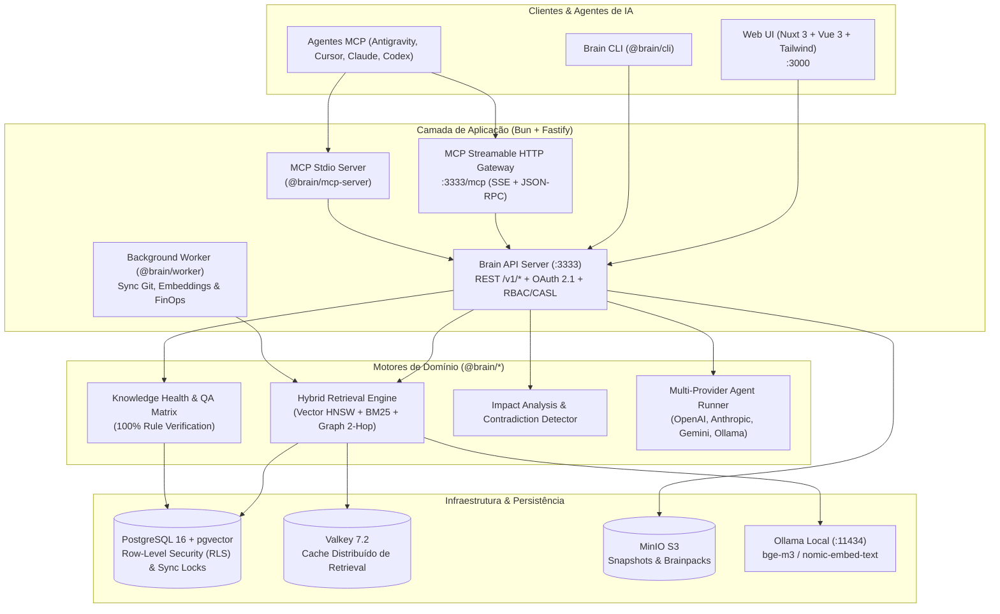

# Brain — Project Brain OS 2.0

**Cérebro corporativo universal para engenharia de software, regras de negócio, arquitetura viva, topologia multicamada 2D/3D e agentes autônomos de IA.**

O **Project Brain OS 2.0** unifica conhecimento estruturado em **`.brain/`** (versionado junto ao código no Git) com indexação híbrida de alta performance no **PostgreSQL 16 (`pgvector` + BM25 + Grafo Relacional + Row-Level Security)**, cache distribuído em **Valkey**, armazenamento de artefatos em **MinIO S3** e exposição nativa via **Web UI (Nuxt 3)**, **API REST (Fastify)** e **Model Context Protocol (MCP — Streamable HTTP & `stdio`)**.

---

## Sumário

1. [Principais Capacidades](#-principais-capacidades)
2. [Arquitetura e Topologia do Sistema](#-arquitetura-e-topologia-do-sistema)
3. [Inicialização Rápida (Bun + Turborepo)](#-inicialização-rápida-bun--turborepo)
4. [Estrutura do Monorepo](#-estrutura-do-monorepo)
5. [Documentação Viva (`.brain/`)](#-documentação-viva-brain)
6. [Regras de Negócio & Cobertura de Testes (100%)](#-regras-de-negócio--cobertura-de-testes-100)
7. [Skills Oficiais de Engenharia (`.brain/skills/`)](#-skills-oficiais-de-engenharia-brainskills)
8. [Conectar Agentes via MCP (108+ Ferramentas)](#-conectar-agentes-via-mcp-108-ferramentas)
9. [Segurança, Multi-Tenancy (RLS + CASL) e Governança](#-segurança-multi-tenancy-rls--casl-e-governança)

---

## Principais Capacidades

### 1. Topologia Multicamada e Visualização de Grafos 2D / 2.5D / 3D
- **Mapa Multicamada do Projeto (`LayersTopologyTab`)**:
  - Conecta visualmente **Arquitetura**, **Negócio**, **Código**, **Produto & Dados** e **Operação**.
  - **7 Modos de Layout**: *Força Direcionada*, *Anéis Concêntricos*, *Radial Central*, *Matriz em Camadas*, *Fluxo Sankey*, *3D Orbital (WebGL)* e *3D Camadas Empilhadas (WebGL)*.
  - **Projeções & Dimensões**: Alternância instantânea entre planos `2D`, `2.5D Isométrico` e `3D Perspectiva`, com dimensionamento proporcional ao grau de conexões, confiança ou uniforme.
- **Grafo Interativo de Conhecimento (`GraphViewTab`)**:
  - **Motor Duplo (Cytoscape 2D & Three.js WebGL 3D)**:
    - **10+ Algoritmos 2D**: `Dagre (Hierárquico)`, `Cola (Física)`, `Radial por Camadas`, `Concêntrico (Grau)`, `Grade Ordenada`, `Árvore (BFS)`, `Circular`, `Orgânico` e `Manual`.
    - **Paletas Dinâmicas**: Cores por *Camada Semântica*, *Status de Aprovação*, *Grau de Conexão (Hubs)* ou *Heatmap de Confiança*.
    - **Estilos Visuais**: Formatos de nós customizáveis, curvas de arestas (`Bezier`, `Ortogonal/Taxi`, `Retas`, `Feixe/Haystack`), modo foco em vizinhança (`1-Hop`), minimapa interativo e exportação direta para **PNG**, **JSON** e **Mermaid**.

### 2. Inteligência para o Dia a Dia de Engenharia
- **"O que mudou desde ontem?" (`brain_what_changed`)**: Resumo diário consolidando alterações em código, regras, documentos e decisões.
- **Busca por Intenção (`brain_intent_search`)**: Responde a perguntas naturais como *"como publicar?"* ou *"quem valida acesso?"* sem exigir o nome exato do módulo.
- **Explicação Contextual de Código (`brain_explain_code`)**: Relaciona trechos de código diretamente às regras de negócio e fluxos existentes.
- **Assistente de Mudança & Blast Radius (`brain_change_assistant` / `brain_analyze_change_impact`)**: Calcula impacto em cascata antes de aprovar mudanças ou PRs.
- **Prévia de Impacto de Decisões (`brain_decision_preview`)**: Compara opções arquiteturais lado a lado mostrando serviços e regras afetadas.
- **Detecção de Contradições (`brain_contradiction_detect`)**: Alerta automaticamente quando duas regras ou ADRs descrevem comportamentos incompatíveis.
- **Painel de Dívida Técnica (`brain_tech_debt_radar`)**: Monitora riscos, dependências frágeis, regras sem testes e decisões que exigem revisão.
- **Revisão de Permissões em Linguagem Simples (`brain_explain_permissions`)**: Explica claramente quem pode alterar cada item e a origem da permissão (RBAC/CASL/JIT).
- **Modo de Exploração Interativa (`InteractiveTourModal`)**: Roteiro guiado passo a passo para onboarding acelerado em projetos complexos.

### 3. Mais de 22 Tipos de Conhecimento Representados
Além de Regras de Negócio (`business_rule`), Decisões Arquiteturais (`architecture_decision`), Fluxos (`process`), Especificações (`spec`), Contratos de API (`api_contract`), Skills (`skill`), Memórias (`memory`) e Testes (`test`), o Brain modela:
- **Glossário de Domínio**, **Capacidades do Produto**, **Modelos de Dados**, **Casos de Uso e Jornadas**, **Riscos e Controles**, **SLOs e Metas Operacionais**, **Runbooks e Incidentes**, **Decisões Pendentes**, **Proveniência da Informação (`KnowledgeProvenance`)**, **Padrões de Implementação**, **Limites e Restrições**, **Papéis e Responsabilidades**, **Matriz de Compatibilidade**, **Vocabulário de Código**, **Experimentos**, **Exceções Conhecidas**, **Dados de Exemplo Anonimizados**, **Dependências Externas** e **Critérios de Aceite**.

---

## Arquitetura e Topologia do Sistema



---

## Inicialização Rápida (Bun + Turborepo)

O projeto possui um **script universal de inicialização em TypeScript** ([`brain/scripts/init.ts`](file:///Users/matheusbrito/tuf/pasta%20sem%20t%C3%ADtulo%204/brain/scripts/init.ts)) que detecta o sistema operacional (macOS Apple Silicon/Intel, Linux, Windows/WSL), valida ou instala **Bun** e **Turborepo**, gera o arquivo `.env` com chaves criptográficas seguras, sobe os contêineres Docker, executa as migrações e bootstrap de roles RLS no PostgreSQL, compila o monorepo via Turborepo e inicia os serviços.

### 1. Subir o Projeto Completo com Um Comando

```bash
cd brain

# Inicialização completa: verifica dependências, sobe Docker, roda migrations, builda via Turbo e inicia tudo
bun run init

# Ou iniciar diretamente em modo Desenvolvimento (Hot-Reload via Turborepo)
bun run init:dev

# Ou iniciar em modo Produção Concorrente (API :3333 + Web :3000 + Worker)
bun run init:start
```

### 2. Comandos Úteis de Diagnóstico e Operação

| Comando | Descrição |
| :--- | :--- |
| `bun run init:doctor` | Executa o **Brain Doctor** (verifica Bun, Turbo, Docker, portas e conectividade PostgreSQL/Valkey) |
| `bun run init:infra` | Sobe apenas a infraestrutura Docker (PostgreSQL 16, Valkey, MinIO, Ollama) e aplica migrações |
| `bun run build` | Compila todos os 29 pacotes e aplicações do monorepo via **Turborepo** (`turbo run build`) |
| `bun run test` | Executa a suíte de testes automatizados em todo o monorepo (`turbo run test`) |
| `bun test tests/business-rules.test.ts` | Executa a verificação direta das 9 Regras de Negócio (`TEST-BR-BRAIN-001` a `009`) |
| `bun run typecheck` | Validação estrita de tipos TypeScript em todos os pacotes |

### 3. Endpoints Locais Padrão

- **Web UI (Painel Principal & Topologia 2D/3D)**: `http://localhost:3000`
- **API REST & Healthcheck**: `http://localhost:3333/health`
- **Gateway MCP (Streamable HTTP)**: `http://localhost:3333/mcp`
- **MinIO Console (S3)**: `http://localhost:9001`

---

## Estrutura do Monorepo

```text
brain/
├── .brain/                    # Base oficial de conhecimento vivo (Regras, ADRs, Fluxos, Skills)
├── apps/
│   ├── api/                   # Servidor Fastify (:3333), Rotas REST, OAuth 2.1, MCP HTTP e RBAC/CASL
│   ├── web/                   # Interface Nuxt 3 + Vue 3 (:3000), Workspaces, Grafos 2D/3D e Dashboards
│   ├── worker/                # Worker assíncrono para ingestão Git, embeddings e lembretes HITL
│   ├── mcp-server/            # Servidor MCP stdio + CLI de login PKCE 1-clique
│   └── cli/                   # CLI para desenvolvedores e automação CI/CD
├── packages/                  # 25+ pacotes modulares de domínio (@brain/*)
│   ├── core/                  # Tipos canônicos, entidades, KnowledgeItem e BrainError
│   ├── auth/                  # Autenticação JWT/API Key, CASL Ability Builder e catálogo de permissões
│   ├── database/              # Schemas Drizzle ORM, migrações SQL e repositórios com RLS transacional
│   ├── retrieval/             # Motor de busca híbrida (pgvector + BM25 + Graph Traversal + Valkey cache)
│   ├── graph/                 # Grafo de conhecimento em memória e PostgreSQL com travessia multi-hop
│   ├── knowledge/             # Repositório de conhecimento, versionamento e expurgo LGPD
│   ├── knowledge-health/      # Motor de saúde arquitetural, detecção de contradições e cobertura
│   ├── enterprise-views/      # Tech Radar, matriz de cobertura QA e relatórios executivos
│   ├── impact-analysis/       # Cálculo de raio de explosão (blast radius) e impacto de mudanças
│   ├── context-engine/        # Montagem inteligente de Context Packs dentro do orçamento de tokens
│   ├── agent-runner/          # Execução multi-provedor com fallback local e controle FinOps
│   ├── approval-engine/       # Fluxos Human-in-the-Loop (HITL) e concessões Just-in-Time (JIT)
│   └── audit-engine/          # Trilha de auditoria imutável encadeada por hash SHA-256
├── scripts/
│   └── init.ts                # Script universal de bootstrap e orquestração Bun + Turborepo
└── tests/
    └── business-rules.test.ts # Suíte de verificação das regras de negócio (BR-BRAIN-001..009)
```

---

## Documentação Viva (`.brain/`)

Toda a documentação arquitetural e operacional reside exclusivamente dentro de [`brain/.brain/`](file:///Users/matheusbrito/tuf/pasta%20sem%20t%C3%ADtulo%204/brain/.brain) e é sincronizada automaticamente com o grafo do Brain:

- **00 — Visão & Produto**:
  - [Visão Geral e Proposta de Valor (`vision.md`)](file:///Users/matheusbrito/tuf/pasta%20sem%20t%C3%ADtulo%204/brain/.brain/00-overview/vision.md)
- **01 — Negócio & Invariantes**:
  - [Catálogo de Regras de Negócio (`BR-BRAIN-001` a `BR-BRAIN-009`)](file:///Users/matheusbrito/tuf/pasta%20sem%20t%C3%ADtulo%204/brain/.brain/01-business/business-rules)
- **02 — Onboarding**:
  - [Guia de Onboarding de Engenharia (`guide.md`)](file:///Users/matheusbrito/tuf/pasta%20sem%20t%C3%ADtulo%204/brain/.brain/02-onboarding/guide.md)
- **03 — Arquitetura & ADRs**:
  - [Topologia do Sistema (`system-topology.md`)](file:///Users/matheusbrito/tuf/pasta%20sem%20t%C3%ADtulo%204/brain/.brain/03-architecture/system-topology.md)
  - [Modelo de Dados & Persistência (`data-model.md`)](file:///Users/matheusbrito/tuf/pasta%20sem%20t%C3%ADtulo%204/brain/.brain/03-architecture/data-model.md)
  - [Topologia dos Workspaces Frontend (`frontend-workspaces-topology.md`)](file:///Users/matheusbrito/tuf/pasta%20sem%20t%C3%ADtulo%204/brain/.brain/03-architecture/frontend-workspaces-topology.md)
  - [Provedores do Agent Runner (`agent-runner-providers.md`)](file:///Users/matheusbrito/tuf/pasta%20sem%20t%C3%ADtulo%204/brain/.brain/03-architecture/agent-runner-providers.md)
  - [Subagentes e Colaboração (`subagents-and-collaboration.md`)](file:///Users/matheusbrito/tuf/pasta%20sem%20t%C3%ADtulo%204/brain/.brain/03-architecture/subagents-and-collaboration.md)
  - [ADR-001: Topologia e Autenticação](file:///Users/matheusbrito/tuf/pasta%20sem%20t%C3%ADtulo%204/brain/.brain/03-architecture/ADR-BRAIN-001-topology-and-auth.md)
  - [ADR-002: Conhecimento em Camadas e MCP](file:///Users/matheusbrito/tuf/pasta%20sem%20t%C3%ADtulo%204/brain/.brain/03-architecture/ADR-BRAIN-002-layered-knowledge-and-mcp.md)
  - [ADR-003: Configurações Dinâmicas e RBAC Global](file:///Users/matheusbrito/tuf/pasta%20sem%20t%C3%ADtulo%204/brain/.brain/03-architecture/ADR-BRAIN-003-dynamic-settings-and-global-rbac.md)
  - [ADR-004: Cache Distribuído Valkey e Storage MinIO](file:///Users/matheusbrito/tuf/pasta%20sem%20t%C3%ADtulo%204/brain/.brain/03-architecture/ADR-BRAIN-004-valkey-cache-and-minio-storage.md)
  - [ADR-005: Streamable HTTP MCP e Inteligência Diária](file:///Users/matheusbrito/tuf/pasta%20sem%20t%C3%ADtulo%204/brain/.brain/03-architecture/ADR-BRAIN-005-streamable-http-mcp-and-daily-intelligence.md)
- **04 — Engenharia & Padrões**:
  - [Padrões de Codificação (`coding-standards.md`)](file:///Users/matheusbrito/tuf/pasta%20sem%20t%C3%ADtulo%204/brain/.brain/04-engineering/coding-standards.md)
  - [Padrões de Implementação (`implementation-patterns.md`)](file:///Users/matheusbrito/tuf/pasta%20sem%20t%C3%ADtulo%204/brain/.brain/04-engineering/implementation-patterns.md)
  - [Limites e Restrições (`limits-and-constraints.md`)](file:///Users/matheusbrito/tuf/pasta%20sem%20t%C3%ADtulo%204/brain/.brain/04-engineering/limits-and-constraints.md)
  - [Matriz de Compatibilidade (`compatibility-matrix.md`)](file:///Users/matheusbrito/tuf/pasta%20sem%20t%C3%ADtulo%204/brain/.brain/04-engineering/compatibility-matrix.md)
  - [Modelo de Segurança e RLS (`security-and-rls-model.md`)](file:///Users/matheusbrito/tuf/pasta%20sem%20t%C3%ADtulo%204/brain/.brain/04-engineering/security-and-rls-model.md)
  - [Contratos de API e MCP (`api-and-mcp-contracts.md`)](file:///Users/matheusbrito/tuf/pasta%20sem%20t%C3%ADtulo%204/brain/.brain/04-engineering/api-and-mcp-contracts.md)
  - [Mapa de Pacotes e Módulos (`packages-and-modules-map.md`)](file:///Users/matheusbrito/tuf/pasta%20sem%20t%C3%ADtulo%204/brain/.brain/04-engineering/packages-and-modules-map.md)
- **05 — Fluxos Operacionais**:
  - [Fluxo OAuth 2.1 PKCE no MCP (`mcp-oauth-flow.md`)](file:///Users/matheusbrito/tuf/pasta%20sem%20t%C3%ADtulo%204/brain/.brain/05-flows/mcp-oauth-flow.md)
  - [Fluxo de Busca Híbrida (`hybrid-retrieval-flow.md`)](file:///Users/matheusbrito/tuf/pasta%20sem%20t%C3%ADtulo%204/brain/.brain/05-flows/hybrid-retrieval-flow.md)
  - [Ingestão e Aprovação HITL (`knowledge-ingestion-and-approval-flow.md`)](file:///Users/matheusbrito/tuf/pasta%20sem%20t%C3%ADtulo%204/brain/.brain/05-flows/knowledge-ingestion-and-approval-flow.md)
  - [Impacto e Blast Radius Cross-Service (`impact-and-cross-service-flow.md`)](file:///Users/matheusbrito/tuf/pasta%20sem%20t%C3%ADtulo%204/brain/.brain/05-flows/impact-and-cross-service-flow.md)
  - [Agent Runner e FinOps (`agent-runner-and-finops-flow.md`)](file:///Users/matheusbrito/tuf/pasta%20sem%20t%C3%ADtulo%204/brain/.brain/05-flows/agent-runner-and-finops-flow.md)
- **06 — Operações & SRE**:
  - [Catálogo Completo de Ferramentas MCP (`mcp-tools-catalog.md`)](file:///Users/matheusbrito/tuf/pasta%20sem%20t%C3%ADtulo%204/brain/.brain/06-operations/mcp-tools-catalog.md)
  - [SLOs e Metas Operacionais (`slo-and-operational-targets.md`)](file:///Users/matheusbrito/tuf/pasta%20sem%20t%C3%ADtulo%204/brain/.brain/06-operations/slo-and-operational-targets.md)
  - [Dependências Externas e Planos de Contingência (`external-dependencies.md`)](file:///Users/matheusbrito/tuf/pasta%20sem%20t%C3%ADtulo%204/brain/.brain/06-operations/external-dependencies.md)
  - [Deploy e Comandos (`deployment-and-commands.md`)](file:///Users/matheusbrito/tuf/pasta%20sem%20t%C3%ADtulo%204/brain/.brain/06-operations/deployment-and-commands.md)
  - [Troubleshooting e Playbooks (`troubleshooting-and-playbooks.md`)](file:///Users/matheusbrito/tuf/pasta%20sem%20t%C3%ADtulo%204/brain/.brain/06-operations/troubleshooting-and-playbooks.md)

---

## Regras de Negócio & Cobertura de Testes (100%)

Todas as regras de negócio são verificadas por testes automatizados vinculados no grafo via arestas `VERIFIED_BY` e auditadas na Matriz de Cobertura Corporativa:

| ID | Regra de Negócio | Teste Associado (`VERIFIED_BY`) | Status |
| :--- | :--- | :--- | :---: |
| [`BR-BRAIN-001`](file:///Users/matheusbrito/tuf/pasta%20sem%20t%C3%ADtulo%204/brain/.brain/01-business/business-rules/BR-BRAIN-001.yaml) | Isolamento Multi-Tenant e Escopo Dinâmico por RBAC/RLS | `TEST-BR-BRAIN-001` | Coberta |
| [`BR-BRAIN-002`](file:///Users/matheusbrito/tuf/pasta%20sem%20t%C3%ADtulo%204/brain/.brain/01-business/business-rules/BR-BRAIN-002.yaml) | Auditoria Imutável, Privacidade LGPD e Varredura de Segredos | `TEST-BR-BRAIN-002` | Coberta |
| [`BR-BRAIN-003`](file:///Users/matheusbrito/tuf/pasta%20sem%20t%C3%ADtulo%204/brain/.brain/01-business/business-rules/BR-BRAIN-003.yaml) | Cotas FinOps por Departamento e Downgrade Automático de Modelo | `TEST-BR-BRAIN-003` | Coberta |
| [`BR-BRAIN-004`](file:///Users/matheusbrito/tuf/pasta%20sem%20t%C3%ADtulo%204/brain/.brain/01-business/business-rules/BR-BRAIN-004.yaml) | Aprovação Human-in-the-Loop (HITL) e Concessões Just-In-Time (JIT) | `TEST-BR-BRAIN-004` | Coberta |
| [`BR-BRAIN-005`](file:///Users/matheusbrito/tuf/pasta%20sem%20t%C3%ADtulo%204/brain/.brain/01-business/business-rules/BR-BRAIN-005.yaml) | Desacoplamento de Configurações Dinâmicas no PostgreSQL (`system_settings`) | `TEST-BR-BRAIN-005` | Coberta |
| [`BR-BRAIN-006`](file:///Users/matheusbrito/tuf/pasta%20sem%20t%C3%ADtulo%204/brain/.brain/01-business/business-rules/BR-BRAIN-006.yaml) | Isolamento de Usuários Sem Projeto Vinculado e Escopo Global CASL (`__global__`) | `TEST-BR-BRAIN-006` | Coberta |
| [`BR-BRAIN-007`](file:///Users/matheusbrito/tuf/pasta%20sem%20t%C3%ADtulo%204/brain/.brain/01-business/business-rules/BR-BRAIN-007.yaml) | Projetos Compartilháveis Globalmente (`isShared`) com Permissões CASL Dedicadas | `TEST-BR-BRAIN-007` | Coberta |
| [`BR-BRAIN-008`](file:///Users/matheusbrito/tuf/pasta%20sem%20t%C3%ADtulo%204/brain/.brain/01-business/business-rules/BR-BRAIN-008.yaml) | Governança, Rastreabilidade e Proveniência de Conhecimento (`KnowledgeProvenance`) | `TEST-BR-BRAIN-008` | Coberta |
| [`BR-BRAIN-009`](file:///Users/matheusbrito/tuf/pasta%20sem%20t%C3%ADtulo%204/brain/.brain/01-business/business-rules/BR-BRAIN-009.yaml) | Avaliação Prévia de Impacto de Mudanças e Detecção de Contradições Arquiteturais | `TEST-BR-BRAIN-009` | Coberta |

---

## Skills Oficiais de Engenharia (`.brain/skills/`)

As skills de agentes estão integradas diretamente em [`brain/.brain/skills/`](file:///Users/matheusbrito/tuf/pasta%20sem%20t%C3%ADtulo%204/brain/.brain/skills) e indexadas no banco do Brain:

1. **[`git-workflow-craftsman`](file:///Users/matheusbrito/tuf/pasta%20sem%20t%C3%ADtulo%204/brain/.brain/skills/git-workflow-craftsman/SKILL.md)**: Conventional Commits 1.0.0 estritos, Trunk-Based Development, commits atômicos e higiene de rebase linear.
2. **[`code-elegance-avoid-if-else`](file:///Users/matheusbrito/tuf/pasta%20sem%20t%C3%ADtulo%204/brain/.brain/skills/code-elegance-avoid-if-else/SKILL.md)**: Eliminação de cadeias de `if/else` com Guard Clauses, Lookup Tables $O(1)$, Strategy Pattern, Discriminated Unions exaustivas (`assertNever`) e pipelines funcionais.
3. **[`frontend-architecture-craft`](file:///Users/matheusbrito/tuf/pasta%20sem%20t%C3%ADtulo%204/brain/.brain/skills/frontend-architecture-craft/SKILL.md)**: Vue 3 e Nuxt 3 modernos com `<script setup lang="ts">`, composables puros (`readonly`), `shallowRef` para grafos 2D/3D pesados e separação Dumb/Smart components.
4. **[`backend-resilience-craft`](file:///Users/matheusbrito/tuf/pasta%20sem%20t%C3%ADtulo%204/brain/.brain/skills/backend-resilience-craft/SKILL.md)**: Clean Architecture com Fastify e Bun, validação TypeBox em runtime, transações PostgreSQL com RLS (`withTenantRls`), `BrainError` e graceful shutdown.
5. **[`fullstack-testing-strategy`](file:///Users/matheusbrito/tuf/pasta%20sem%20t%C3%ADtulo%204/brain/.brain/skills/fullstack-testing-strategy/SKILL.md)**: Pirâmide de testes moderna (unitários com Bun Test, integração real contra PostgreSQL RLS e E2E com Fastify `app.inject()`), rastreabilidade `VERIFIED_BY` e determinismo.
6. **[`modern-language-features`](file:///Users/matheusbrito/tuf/pasta%20sem%20t%C3%ADtulo%204/brain/.brain/skills/modern-language-features/SKILL.md)**: Recursos avançados de TypeScript 5+ (`satisfies`, `const` type parameters, `using` / `Symbol.dispose`), ES2024+ (`Object.groupBy`, `Promise.withResolvers`, `toSorted`, `structuredClone`), Bun nativo e PostgreSQL JSONB.
7. **[`brain-mcp-advisor`](file:///Users/matheusbrito/tuf/pasta%20sem%20t%C3%ADtulo%204/brain/.brain/skills/brain-mcp-advisor/SKILL.md)**: Protocolo para agentes consultarem e atualizarem o MCP Brain antes, durante e após tarefas.
8. **[`brain-knowledge-hygiene`](file:///Users/matheusbrito/tuf/pasta%20sem%20t%C3%ADtulo%204/brain/.brain/skills/brain-knowledge-hygiene/SKILL.md)**: Diretrizes para manter regras, ADRs, critérios de aceite e vínculos de testes sempre sincronizados.

---

## Conectar Agentes via MCP (108+ Ferramentas)

O Brain expõe mais de **108 ferramentas MCP** para agentes como **Antigravity**, **Cursor**, **Claude Code** e **Codex**:

### Opção 1: Transporte Streamable HTTP (Recomendado)
- **URL do Servidor MCP**: `http://localhost:3333/mcp`
- Suporta autenticação via **Bearer Token** (`Authorization: Bearer <BRAIN_LOCAL_API_KEY>` ou JWT) e descoberta **OAuth 2.1 com PKCE**.

### Opção 2: Transporte `stdio` com Login 1-Clique
```bash
# Autentica no navegador e grava credenciais locais
bun brain/apps/mcp-server/dist/index.js login
```

---

## Segurança, Multi-Tenancy (RLS + CASL) e Governança

- **Row-Level Security (RLS) Forçado no PostgreSQL**: Todas as tabelas sensíveis validam `app.current_tenant_id`, `app.allowed_projects` e `app.allowed_policies` diretamente na engine do banco de dados.
- **Autorização Isomórfica CASL**: Mesma árvore de permissões avaliada no backend Fastify e no frontend Nuxt 3, incluindo suporte a escopo global (`__global__`) e projetos compartilhados (`isShared`).
- **Prevenção de Vazamento de Segredos**: Varredura automática (`scanForSecrets`) antes de qualquer ingestão ou commit e mascaramento de configurações sensíveis em `system_settings`.
- **Modularidade Estrita**: Todo arquivo do repositório respeita rigorosamente o limite máximo de **700 linhas**, garantindo legibilidade e facilidade de manutenção.
