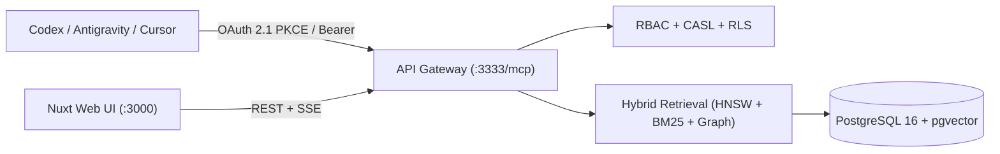

# Visão Geral do Brain

O **Brain** centraliza arquitetura, regras de negócio, topologias em camadas, fluxos, contratos cross-service, memória episódica/semântica e governança RBAC/CASL em um único grafo pesquisável (FTS + HNSW `pgvector` + Grafo de Relações) exposto via API REST, Web UI e **MCP (Streamable HTTP + stdio)**.

