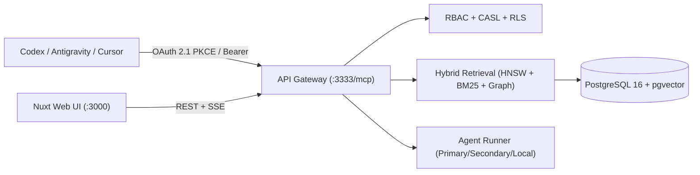

# Visão Geral do Brain

O **Brain** centraliza arquitetura, regras de negócio, topologias em camadas, fluxos, contratos cross-service, memória episódica/semântica e governança RBAC/CASL em um único grafo pesquisável (**FTS/BM25 + HNSW `pgvector` + Grafo Recursivo**) exposto via **Web UI (`:3000`)**, **API REST (`:3333`)** e **MCP (`Streamable HTTP` + `stdio`)**.

## Pilares do Sistema
1. **Conhecimento Vivo em `.brain/`**: Fonte de verdade versionada em Git (sem pasta `docs/`), indexada com embeddings `bge-m3`.
2. **Segurança & Multi-Tenancy**: OAuth 2.1 PKCE, Device Flow 1-clique, tokens revogáveis (`auth_mcp_tokens`), CASL e PostgreSQL RLS.
3. **Governança & Qualidade**: Regras de negócio (`BR-BRAIN-*`) vinculadas a testes (`VERIFIED_BY`) e análise de impacto cross-service.
4. **Runner Multi-Provider**: Execução orquestrada com roteamento primário/secundário/fallback, cotas FinOps e handoffs.

