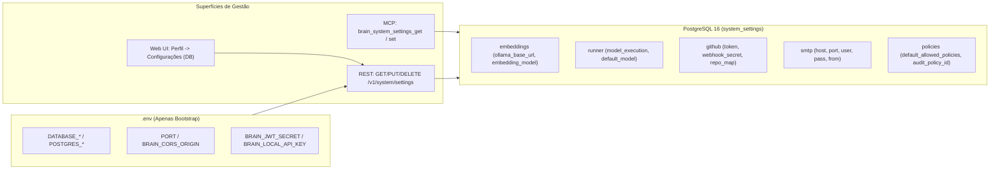

# ADR-BRAIN-003 — Configurações Dinâmicas em Banco (`system_settings`) e Escopo Global de Acesso (`__global__`)

## Contexto

Anteriormente, o Brain dependia de variáveis em `.env` para parâmetros dinâmicos de runtime (`OLLAMA_BASE_URL`, `EMBEDDING_MODEL`, `RUNNER_MODEL`, `SMTP_*`, `GITHUB_TOKEN`, `BRAIN_ALLOWED_PROJECTS`, `BRAIN_ALLOWED_POLICIES`) e forçava um fallback automático para projetos do tenant quando um usuário ficava com `allowedProjects: []`. Isso causava dois problemas arquiteturais:
1. Alterar provedores de embedding, modelos do runner, credenciais SMTP ou integrações exigia editar `.env` e reiniciar processos manualmente.
2. Quando um administrador removia todos os projetos de um usuário, o fallback reatribuía visualmente os projetos existentes ou bloqueava a guia **Acesso, CASL & Políticas** por falta de `projectId`.

## Decisão

### 1. Tabela `system_settings` e `.env` Minimalista
Criamos a tabela `system_settings` no PostgreSQL 16 (gerenciada por `PgSystemSettingsRepository` em `@brain/database`) com chave única `(tenant_id, category, key)`, valor `jsonb` e flag `is_secret`.

### 2. Isolamento Zero-Project e Escopo `__global__` para CASL/RBAC
- `resolveDynamicMcpScope` não injeta projetos do tenant automaticamente para usuários reais (`actorId !== "local-dev"`). Se `allowedProjects` é `[]` e não há registros em `project_access_members` nem `temporary_access_grants`, o usuário permanece com `allowedProjects: []`.
- `syncUserProjectMemberships` limpa registros obsoletos de `project_access_members` sempre que `PUT /v1/projects/:projectId/access/users/:userId/scopes` atualiza os projetos permitidos.
- `authenticateProjectRequest` aceita o identificador reservado `__global__`, validando identidade e permissões CASL (`roles:view`, `roles:manage`, `users:assign_roles`) sem exigir vínculo com um projeto específico.
- `GET /v1/projects?scope=catalog` permite que o modal de escopos liste os projetos cadastrados no tenant para vinculação por tags, enquanto `GET /v1/projects` retorna estritamente os projetos vinculados ao usuário autenticado.

## Consequências

- **Positivas**:
  - `.env` enxuto, seguro e restrito a infraestrutura/bootstrap.
  - Configurações editáveis em tempo real pela Web UI, API REST e agentes MCP com mascaramento de segredos (`••••••••`).
  - Usuários sem projeto vinculado podem logar, navegar pelas guias permitidas sem vazamento de dados de projetos e administrar usuários/permissões CASL via `__global__`.
- **Regras de Negócio Relacionadas**: `BR-BRAIN-001`, `BR-BRAIN-005`, `BR-BRAIN-006`.
