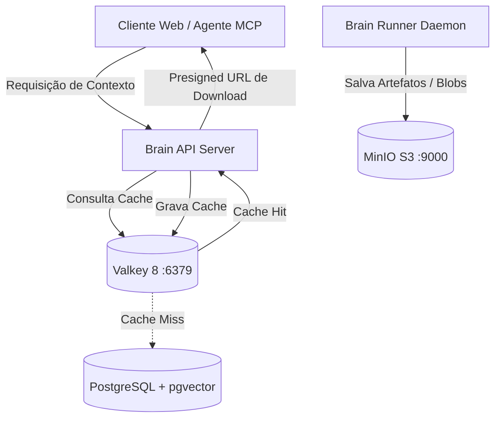

# ADR-BRAIN-004: Adoção de Valkey para Cache Distribuído e MinIO para Armazenamento S3

## Contexto & Desafio
O Project Brain OS opera um mecanismo de busca híbrida de alta performance combinando busca léxica (BM25 / ILIKE / ParadeDB) e busca semântica vetorial (HNSW via pgvector).
Anteriormente, o sistema utilizava apenas um cache local em memória (LRU em Node.js/Bun) no pacote `@brain/retrieval`. Em ambientes com múltiplos nós, reinicializações ou subagentes concorrentes:
1. O cache local era perdido a cada restart da API ou do Worker.
2. Cada instância reprocessava embeddings e buscas idênticas, elevando latência e consumo de CPU/GPU.
3. Arquivos binários, relatórios de auditoria e artefatos de subagentes eram mantidos no filesystem local, dificultando escalabilidade e backup centralizado.

## Decisão de Arquitetura

Adotou-se uma infraestrutura leve, open source e totalmente conteinerizada com **Valkey 8** e **MinIO**:

1. **Valkey 8 (`docker-valkey-1` na porta 6379)**:
   - Utilizado como camada de cache distribuído primário via classe `ValkeyRetrievalCache`.
   - Chaves isoladas por tenant e projeto: `brain:cache:{tenantId}:{projectId}:{queryHash}`.
   - TTL automático (padrão: 3600 segundos) com expiração controlada.
   - Fallback gracioso: caso o contêiner Valkey esteja temporariamente inacessível, o sistema opera automaticamente em modo LRU em memória sem causar falhas nas requisições.

2. **MinIO (`docker-minio-1` nas portas 9000 para API S3 e 9001 para Console Web)**:
   - Armazenamento durável de blobs, anexos de documentos, snapshots de auditoria e artefatos de subagentes do Brain Runner.
   - Compatibilidade total com a API padrão AWS S3 via `@aws-sdk/client-s3`.
   - Buckets isolados por organização: `brain-artifacts`, `brain-audit-snapshots`.
   - URLs de download com assinatura temporária (presigned URLs com expiração configurada).

## Diagrama de Integração

## Consequências & Impactos

### Positivas
- Redução drástica da latência de busca repetida (de ~180ms para < 5ms em cache hits).
- Resiliência operacional: reinicializações do servidor não invalidam o contexto dos agentes.
- Armazenamento seguro de snapshots de auditoria em conformidade com políticas corporativas.

### Mitigações
- O contêiner `docker-valkey-1` e `docker-minio-1` estão configurados no `docker-compose.yml` para reinício automático (`restart: unless-stopped`).
