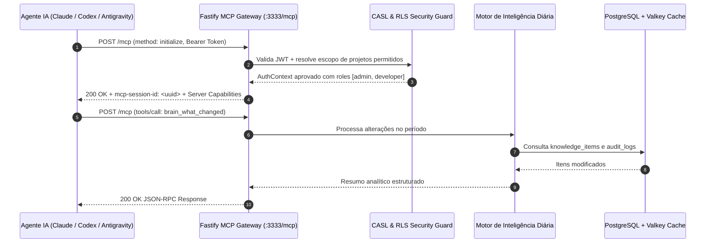

# ADR-BRAIN-005: Gateway Universal Streamable HTTP MCP e Motor de Inteligência para o Dia a Dia

## Contexto & Desafio
O protocolo Model Context Protocol (MCP) da Anthropic estabeleceu o padrão de interoperabilidade entre agentes de IA e repositórios de contexto.
Originalmente, o Brain dependia de conexões locais baseadas em processos stdio CLI (`brain-mcp`). Essa abordagem apresentava limitações:
1. Agentes remotos ou em contêineres não conseguiam acessar o cérebro sem SSH ou pipes locais.
2. Não havia suporte a sessões HTTP com reconexão resiliente e streaming Server-Sent Events (SSE).
3. Desenvolvedores e agentes precisavam de ferramentas cognitivas para o dia a dia, como entender o que mudou nas últimas 24h, intenções de busca semântica, comparação preditiva de decisões e revisão contextual de código.

## Decisão de Arquitetura

1. **Gateway MCP Streamable HTTP no Fastify (`POST /mcp` e `GET /mcp`)**:
   - Implementado utilizando a biblioteca oficial `@modelcontextprotocol/sdk/server/streamableHttp.js`.
   - Autenticação transparente via JWT ou Token MCP Bearer com escopo de tenant e projeto resolvido dinamicamente.
   - Headers `mcp-session-id` para gerenciamento de estado e multiplexação de requisições.

2. **Motor de Inteligência e Ferramentas do Dia a Dia**:
   - Exposição de ferramentas analíticas para agentes e desenvolvedores:
     - `brain_what_changed`: Relatório executivo de alterações em regras, ADRs e docs nas últimas 24h, 48h ou 7 dias.
     - `brain_intent_search`: Classificador semântico de intenções (deploy, segurança, arquitetura, incidentes).
     - `brain_explain_code`: Análise contextual de trechos de código contra regras e ADRs ativos do projeto.
     - `brain_decision_preview`: Simulação lado a lado do impacto de duas opções arquiteturais (Opção A vs B).
     - `brain_team_memory`: Persistência de preferências de squad e memórias de agentes com TTL (`validUntil`).
     - `brain_explain_permissions`: Tradutor em linguagem natural de regras CASL e políticas RLS ("Quem pode alterar?").
     - `brain_internal_examples`: Localizador de padrões e código aprovado implementado no próprio repositório.

## Diagrama da Topologia MCP Streamable HTTP

## Consequências
- Conexão universal a partir de qualquer IDE, webhook, script Python ou cliente HTTP MCP.
- Governança rigorosa: nenhuma chamada MCP ignora as políticas CASL ou o isolamento multi-tenant do banco.
