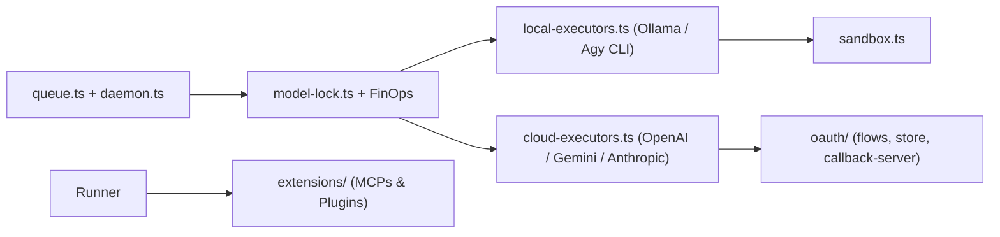

# Arquitetura do `apps/agent-runner`

- **Módulos**: `queue.ts`, `sandbox.ts`, `local-executors.ts`, `cloud-executors.ts`, `model-lock.ts`, `daemon.ts`, `oauth/*`, `extensions/*`.
- **Extensões**: gerenciamento e teste de servidores MCP externos e plugins em `extensions/manager.ts`, `mcp-tester.ts`, `presets.ts`.
