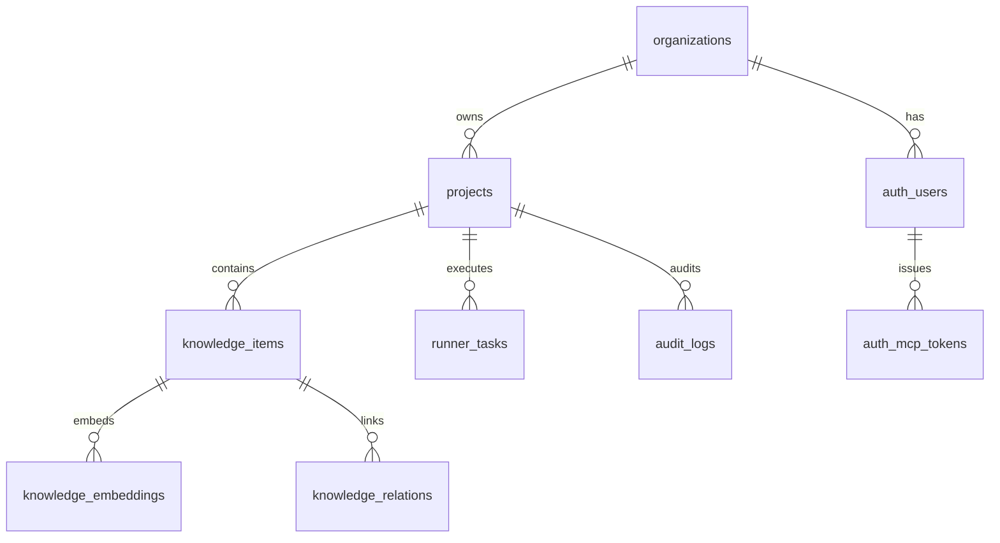

# Modelo de Dados Principal

- **RLS (Row-Level Security)**: `projects`, `knowledge_items`, `knowledge_relations`, `project_access_members` e `temporary_access_grants` usam `app.current_tenant_id`, `app.allowed_projects` e `app.allowed_policies`.
- **Busca Vetorial**: `knowledge_embeddings` armazena vetores `bge-m3` indexados via HNSW no `pgvector`.
