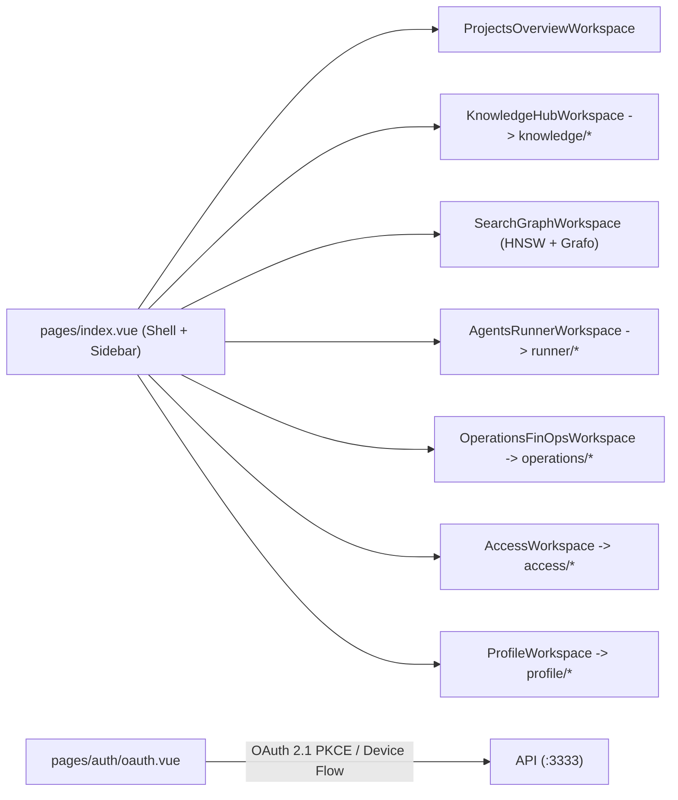

# Arquitetura Modular do Frontend (`brain/apps/web`)

- **Pastas modulares**: `components/access/`, `components/knowledge/`, `components/operations/`, `components/profile/`, `components/runner/models/`, `components/runner/extensions/`.
- **Perfil & MCP**: `ProfileWorkspace.vue` centraliza `Conta & Permissões`, `OAuth2 IA & MCP` (aprovação 1-clique) e `Tokens MCP & Codex` (geração/revogação persistida no PostgreSQL).
