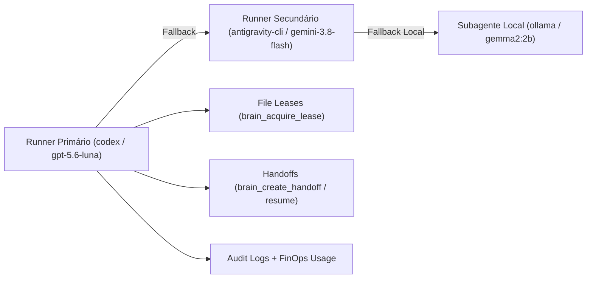

# Agentes, Subagentes e Continuidade

- **Isolamento de Edição**: Agentes adquirem `file leases` (`brain_acquire_lease`) antes de modificar arquivos em paralelo, evitando conflitos.
- **Continuidade**: `brain_create_handoff` e `brain_resume_handoff` preservam decisões, pendências e estado entre sessões.
- **Roteamento Resiliente**: `codex` (primário) → `antigravity-cli` (secundário) → `ollama` / `9router` (fallbacks).
