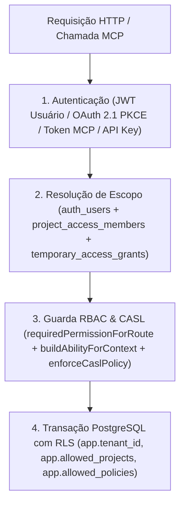

# Modelo de Segurança, CASL, Escopo `__global__` e RLS PostgreSQL

## 1. Camadas de Defesa em Profundidade

## 2. Isolamento de Usuários Sem Projeto (`BR-BRAIN-006`)

1. **Sem Herança Automática Indevida**: usuários reais (`actorId !== "local-dev"`) cujo `allowedProjects` em `auth_users` seja `[]` não recebem projetos do tenant automaticamente em `resolveDynamicMcpScope`.
2. **Desvinculação Consistente**: `syncUserProjectMemberships` remove linhas residuais de `project_access_members` no ato da atualização de escopos (`PUT /v1/projects/:projectId/access/users/:userId/scopes`).
3. **Escopo Global Administrativo (`__global__`)**: a rota `/v1/projects/__global__/access/*` autentica o usuário e valida suas permissões CASL (`roles:view`, `roles:manage`, `users:assign_roles`) sem exigir acesso a um projeto, permitindo administrar usuários, cargos e vínculos mesmo quando o administrador não está vinculado a nenhum projeto.

## 3. Proteção de Segredos e Auditoria (`BR-BRAIN-002` & `BR-BRAIN-005`)

- **Varredura Pré-Ingestão**: `scanForSecrets` bloqueia chaves privadas, tokens GitHub (`ghp_*`, `gho_*`), chaves AWS e credenciais hardcoded antes de persistir propostas ou documentos.
- **Mascaramento em `system_settings`**: parâmetros com `is_secret = true` são retornados como `"••••••••"` em `GET /v1/system/settings` e `brain_system_settings_get`.
- **Trilha Imutável**: todas as alterações de escopo, decisões HITL, configurações globais e execuções MCP geram eventos em `audit_logs`.
