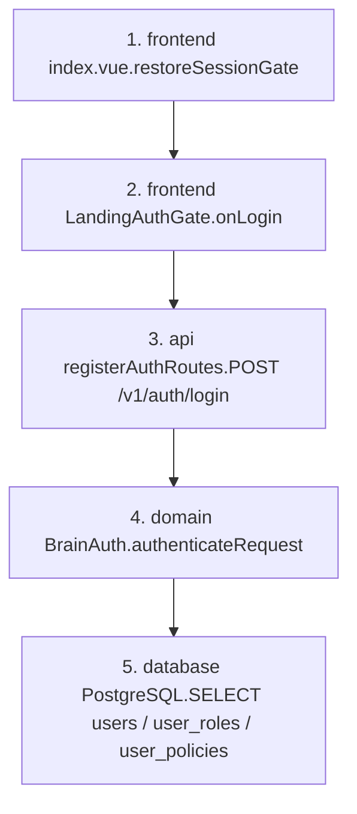

# Ciclo de Vida da Autenticação Web, Gate Inicial e Sessão Zero-Flash

**Entrypoint:** `apps/web/app/pages/index.vue`

## Ciclo de Vida por Camada

1. **[frontend]** `index.vue.restoreSessionGate` (`apps/web/app/pages/index.vue`) — In: Cookie/localStorage session token | Out: authReady boolean + currentUser
2. **[frontend]** `LandingAuthGate.onLogin` (`apps/web/app/components/LandingAuthGate.vue`) — In: email, password | Out: POST /v1/auth/login
3. **[api]** `registerAuthRoutes.POST /v1/auth/login` (`apps/api/src/routes/auth.ts`) — In: Credenciais email + password | Out: Session token + user profile
4. **[domain]** `BrainAuth.authenticateRequest` (`packages/auth/src/index.ts`) — In: Authorization header / session token | Out: AuthContext (tenantId, roles, allowedProjects)
5. **[database]** `PostgreSQL.SELECT users / user_roles / user_policies` (`packages/storage/src/schema.ts`) — In: userId, tenantId | Out: Sessão autenticada e escopo RLS

## Diagrama Mermaid

