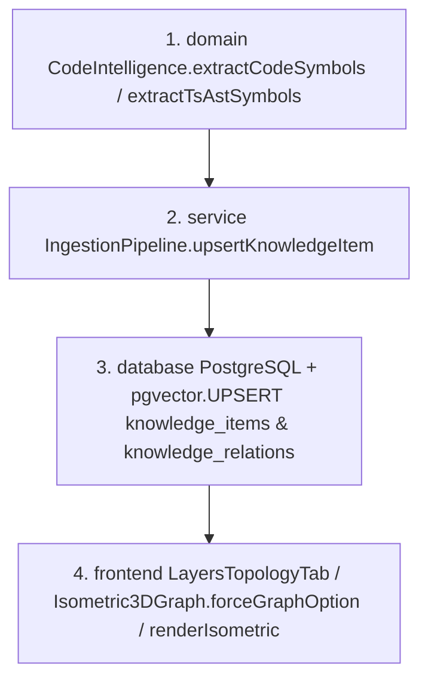

# Extração AST Tree-sitter, Símbolos e Topologia de 5 Camadas

**Entrypoint:** `extractCodeSymbols -> LayersTopologyTab.vue`

## Ciclo de Vida por Camada

1. **[domain]** `CodeIntelligence.extractCodeSymbols / extractTsAstSymbols` (`packages/code-intelligence/src/symbols.ts`) — In: filePath, sourceCode | Out: CodeSymbol[] + fileDependencies[]
2. **[service]** `IngestionPipeline.upsertKnowledgeItem` (`apps/api/src/routes/ingest-document.ts`) — In: Símbolos extraídos + embeddings pgvector | Out: Nós e arestas DEPENDS_ON / IMPACTS
3. **[database]** `PostgreSQL + pgvector.UPSERT knowledge_items & knowledge_relations` (`packages/storage/src/schema.ts`) — In: Embeddings vetoriais + metadados de camada | Out: Topologia persistida por camada
4. **[frontend]** `LayersTopologyTab / Isometric3DGraph.forceGraphOption / renderIsometric` (`apps/web/app/components/knowledge/LayersTopologyTab.vue`) — In: TopologyItem[] agrupados em 5 camadas | Out: Visualização 3D Isométrica, 2D Force, Matriz e Mermaid

## Diagrama Mermaid

