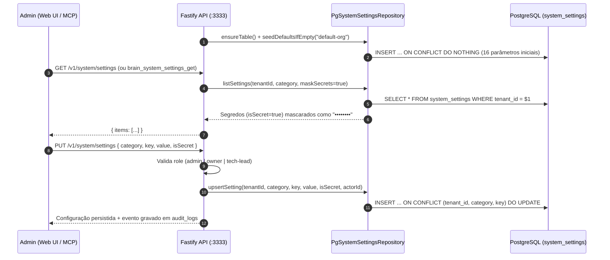
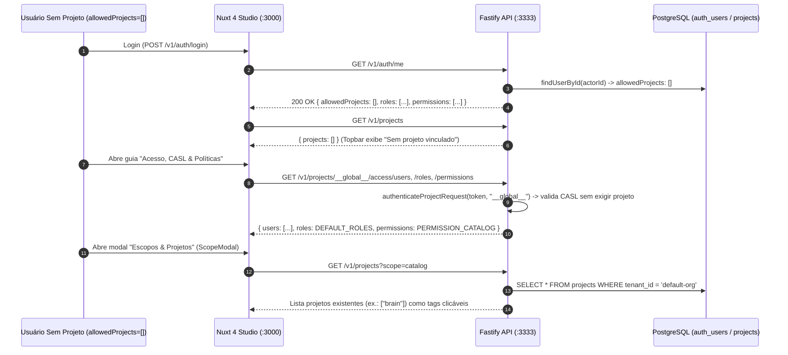

# Fluxo de Configurações Dinâmicas (`system_settings`) e RBAC Sem Projeto (`__global__`)

## 1. Ciclo de Vida de `system_settings` (Seed, Leitura Mascarada e Atualização)

## 2. Fluxo de Desvinculação de Projetos e Acesso Global CASL (`__global__`)

