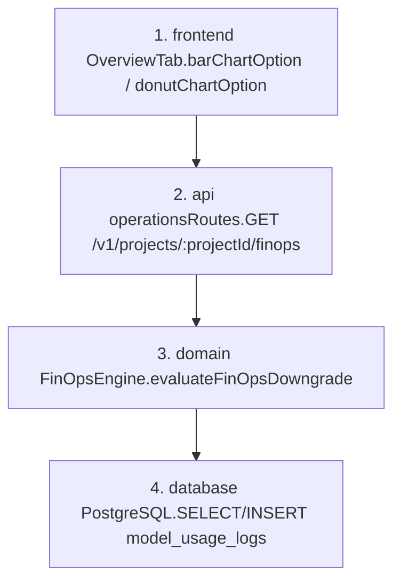

# Telemetria FinOps, Custos de Infra/Energia e Downgrade Automático

**Entrypoint:** `FinOpsTracker -> OverviewTab.vue`

## Ciclo de Vida por Camada

1. **[frontend]** `OverviewTab.barChartOption / donutChartOption` (`apps/web/app/components/operations/OverviewTab.vue`) — In: FinOpsData (modelUsage + infrastructureEstimate) | Out: Gráficos ECharts adaptativos (claro/escuro)
2. **[api]** `operationsRoutes.GET /v1/projects/:projectId/finops` (`apps/api/src/routes/operations.ts`) — In: projectId, period (7d/30d/90d/all) | Out: Resumo consolidado de custos e cotas
3. **[domain]** `FinOpsEngine.evaluateFinOpsDowngrade` (`packages/core/src/finops.ts`) — In: Custo acumulado vs budget mensal | Out: Decisão de roteamento cloud vs Ollama local
4. **[database]** `PostgreSQL.SELECT/INSERT model_usage_logs` (`packages/storage/src/schema.ts`) — In: provider, model, tokens, cost_usd | Out: Séries temporais de consumo FinOps

## Diagrama Mermaid

