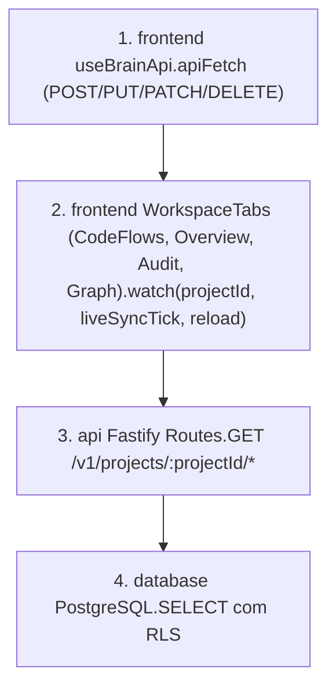

# Sincronização Dinâmica em Tempo Real (Live Sync) Sem F5

**Entrypoint:** `useBrainApi().liveSyncTick`

## Ciclo de Vida por Camada

1. **[frontend]** `useBrainApi.apiFetch (POST/PUT/PATCH/DELETE)` (`apps/web/app/composables/useBrainApi.ts`) — In: Requisição de mutação bem-sucedida | Out: Incrementa liveSyncTick.value
2. **[frontend]** `WorkspaceTabs (CodeFlows, Overview, Audit, Graph).watch([projectId, liveSyncTick], reload)` (`apps/web/app/components/knowledge/CodeFlowsTab.vue`) — In: Novo valor de liveSyncTick | Out: Re-fetch silencioso dos endpoints GET
3. **[api]** `Fastify Routes.GET /v1/projects/:projectId/*` (`apps/api/src/server.ts`) — In: AuthContext + projectId | Out: Estado atualizado do banco
4. **[database]** `PostgreSQL.SELECT com RLS` (`packages/storage/src/schema.ts`) — In: tenant_id, project_id | Out: Dados frescos sem cache obsoleto

## Diagrama Mermaid

