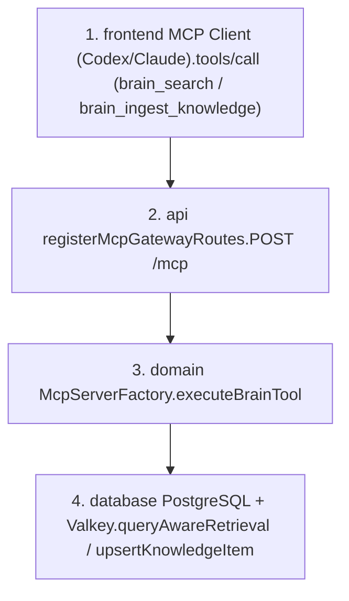

# Gateway MCP Streamable HTTP e Execução de Ferramentas por Agentes

**Entrypoint:** `POST /mcp (Streamable HTTP)`

## Ciclo de Vida por Camada

1. **[frontend]** `MCP Client (Codex/Claude).tools/call (brain_search / brain_ingest_knowledge)` (`apps/mcp-server/src/cli-auth.ts`) — In: Access Token OAuth 2.1 + JSON-RPC payload | Out: POST /mcp com Bearer Token
2. **[api]** `registerMcpGatewayRoutes.POST /mcp` (`apps/api/src/routes/mcp-gateway.ts`) — In: FastifyRequest com JSON-RPC | Out: Streamable HTTP SSE/JSON response
3. **[domain]** `McpServerFactory.executeBrainTool` (`apps/mcp-server/src/index.ts`) — In: toolName, args, AuthContext | Out: Resultado da ferramenta MCP
4. **[database]** `PostgreSQL + Valkey.queryAwareRetrieval / upsertKnowledgeItem` (`packages/retrieval/src/index.ts`) — In: tenant_id, project_id, embeddings/BM25 | Out: Itens de conhecimento ou mutação persistida

## Diagrama Mermaid

