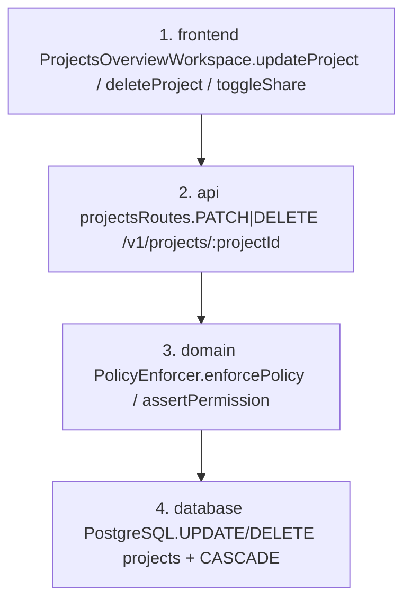

# Gestão de Projetos, Compartilhamento Global e Exclusão

**Entrypoint:** `ProjectsOverviewWorkspace.vue -> /v1/projects`

## Ciclo de Vida por Camada

1. **[frontend]** `ProjectsOverviewWorkspace.updateProject / deleteProject / toggleShare` (`apps/web/app/components/ProjectsOverviewWorkspace.vue`) — In: projectId, name, description, isShared | Out: HTTP PATCH/DELETE /v1/projects/:projectId
2. **[api]** `projectsRoutes.PATCH|DELETE /v1/projects/:projectId` (`apps/api/src/routes/projects-knowledge/projects.ts`) — In: AuthContext + payload do projeto | Out: 200 OK com estado atualizado
3. **[domain]** `PolicyEnforcer.enforcePolicy / assertPermission` (`apps/api/src/runtime/stores.ts`) — In: ctx, action (write/share/delete) | Out: Autorização CASL validada
4. **[database]** `PostgreSQL.UPDATE/DELETE projects + CASCADE` (`packages/storage/src/schema.ts`) — In: tenant_id, project_id | Out: Registro atualizado ou removido

## Diagrama Mermaid

