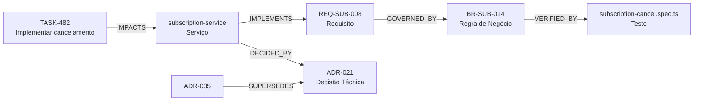

# Modelo de Dados e Knowledge Graph

O **Project Brain OS** não armazena conhecimento apenas como texto livre para embeddings. Toda informação relevante é representada por **entidades tipadas**, com **proveniência**, **ciclo de vida** e **relacionamentos explícitos** em um Knowledge Graph.

---

## 1. Entidades Principais

| Entidade | Descrição | Exemplo |
| :--- | :--- | :--- |
| `Organization` | Organização ou unidade de negócio | `acme-corp` |
| `Project` | Projeto ou produto isolado | `subscription-platform` |
| `KnowledgeItem` | Contrato base de qualquer item de conhecimento | Qualquer entidade versionada |
| `BusinessRule` | Regra de negócio estruturada (condições, efeitos, exceções) | `BR-SUB-014` |
| `Requirement` | Requisito funcional ou não-funcional | `REQ-SUB-008` |
| `ArchitectureDecision` | ADR com contexto, decisão e alternativas rejeitadas | `ADR-021` |
| `CodeSymbol` | Função, classe, módulo, endpoint ou tabela extraída via AST | `SubscriptionService.cancel` |
| `Task` | Épico, história, tarefa ou bug com critérios de aceite | `TASK-482` |
| `Process` | Fluxo ou processo de negócio ponta a ponta | `PROC-CANCEL-FLOW` |
| `Integration` | Sistema externo, API ou webhook integrado | `StripeGateway` |
| `Memory` | Registro de memória episódica, semântica ou procedural | `MEM-SESSION-991` |
| `Evidence` | Fonte original, commit, trecho ou documento comprobatório | `commit:a1b2c3d` |

---

## 2. Contrato Base (`KnowledgeItem`)

Toda entidade de conhecimento implementa o contrato abaixo (em `packages/core`):

```typescript
export type KnowledgeStatus =
  | "draft"
  | "approved"
  | "deprecated"
  | "superseded";

export type TrustLevel = "verified" | "self_authored" | "untrusted";

export type KnowledgeType =
  | "business_rule"
  | "requirement"
  | "feature"
  | "architecture_decision"
  | "code_symbol"
  | "test"
  | "service"
  | "api_contract"
  | "event_contract"
  | "task"
  | "process"
  | "integration"
  | "risk"
  | "memory"
  | "document";

export interface KnowledgeItem {
  id: string;
  tenantId: string;
  projectId: string; // '__org__' para itens globais da organização
  domainId: number; // 1 a 12 (ver os 12 domínios)
  type: KnowledgeType;

  title: string;
  content: string;
  summary?: string;

  status: KnowledgeStatus;

  // Proveniência, versão e rastreabilidade
  sourceId: string;
  sourceOrigin: "internal" | "external_reference";
  sourceKind: "git" | "api" | "connector" | "agent";
  sourceVersion: string; // commit_sha quando sourceKind === 'git'; 'vN' para api/connector/agent
  sourceUri: string;
  version: number; // Versão numérica incremental por mudança de contentHash
  contentHash: string; // SHA-256 canônico

  // Governança, epistemologia e validade
  ownerId?: string;
  confidence: number; // 0.0 a 1.0 (1.0 para descobertas determinísticas e fontes aprovadas)
  trustLevel: TrustLevel;
  isInferred: boolean;
  validFrom?: string;  // ISO-8601 UTC
  validUntil?: string; // ISO-8601 UTC

  tags: string[];
  relatedIds: string[];
  accessPolicyId: string;

  // Dados estruturados específicos do tipo (ex: conditions/effects para BusinessRule)
  metadata?: Record<string, unknown>;

  deletedAt?: string; // Soft delete / tombstone para Edge Sync
  createdAt: string;
  updatedAt: string;
}
```

> **Separação de Índices:** Os embeddings vetoriais **não** ficam misturados dentro do JSON da entidade; eles são armazenados em tabela/índice separado ligados por `(knowledge_item_id, source_version, chunk_index)` para permitir reindexação incremental e filtragem por permissão antes da busca vetorial.

---

## 3. Exemplo de Regra de Negócio Estruturada

```yaml
id: BR-SUB-014
type: business_rule
project: subscription-platform

title: Cancelamento de assinatura
status: approved
priority: critical

description: >
  O cliente pode solicitar o cancelamento da assinatura.

conditions:
  - Assinatura deve existir e estar ativa
  - Usuário deve ser autorizado (titular ou admin da conta)

effects:
  - Registrar solicitação de cancelamento com timestamp
  - Atualizar estado da assinatura conforme política de vigência
  - Executar política de cobrança proporcional ou reembolso

exceptions:
  - Pagamento em disputa (chargeback aberto)
  - Restrições contratuais de fidelidade

related:
  requirements:
    - REQ-SUB-008
  services:
    - subscription-service
  decisions:
    - ADR-021
  tests:
    - subscription-cancel.spec.ts

owner: product-team
version: 3
```

---

## 4. Ontologia do Knowledge Graph

O grafo conecta entidades de negócio, arquitetura, código e execução por meio de arestas tipadas e direcionadas:

| Tipo de Relação | Origem -> Destino | Significado |
| :--- | :--- | :--- |
| `IMPLEMENTS` | `CodeSymbol` / `Service` -> `Requirement` | Um código ou serviço implementa um requisito |
| `GOVERNED_BY` | `Feature` / `CodeSymbol` -> `BusinessRule` | Uma funcionalidade obedece a uma regra de negócio |
| `DEPENDS_ON` | `Component` -> `Component` / `Integration` | Dependência técnica ou operacional |
| `DECIDED_BY` | `Component` / `Requirement` -> `ArchitectureDecision` | Escolha técnica definida por uma ADR |
| `VERIFIED_BY` | `BusinessRule` / `Requirement` -> `Test` (`CodeSymbol`) | Comportamento validado por teste automatizado |
| `BLOCKED_BY` | `Task` -> `Task` / `Risk` | Tarefa impedida por outra pendência |
| `SUPERSEDES` | `KnowledgeItem` -> `KnowledgeItem` | Nova decisão ou regra substitui uma anterior |
| `IMPACTS` | `KnowledgeItem` -> `KnowledgeItem` | Alteração na origem afeta o destino |
| `CONSUMES_API` | `Service` (Projeto A) -> `APIContract` (Projeto B) | Microsserviço consome endpoint/gRPC de outro projeto |
| `PUBLISHES_EVENT` | `Service` (Projeto A) -> `EventContract` | Serviço publica evento de domínio |
| `SUBSCRIBES_TO` | `Service` (Projeto B) -> `EventContract` | Microsserviço assina evento publicado por outro projeto |
| `CO_ACCESSED_WITH` | `KnowledgeItem` -> `KnowledgeItem` | Reforço aprendido via *Context Hit Rate* em sessões reais |



> **Regra de Epistemologia:** Relações extraídas por inferência de IA ou heurísticas (sem evidência explícita em código, ADR ou arquivo YAML) devem ser marcadas com `is_inferred = true` e `confidence < 1.0`, sendo apresentadas ao usuário/agente como **hipóteses**, nunca como fatos confirmados.

---

## 5. Schema no PostgreSQL (FTS + `pgvector` + Grafo)

O PostgreSQL centraliza dados estruturados, busca lexical via PostgreSQL FTS, busca vetorial (**`pgvector`**) e o grafo de relações. ParadeDB BM25 é um upgrade opcional; RLS limita todas as consultas ao escopo autorizado.

```sql
-- Extensões necessárias na configuração padrão
CREATE EXTENSION IF NOT EXISTS "uuid-ossp";
CREATE EXTENSION IF NOT EXISTS "vector";

-- 1. Organizações e Projetos
CREATE TABLE organizations (
  id TEXT PRIMARY KEY,
  name TEXT NOT NULL,
  created_at TIMESTAMPTZ NOT NULL DEFAULT NOW()
);

CREATE TABLE projects (
  id TEXT PRIMARY KEY,
  tenant_id TEXT NOT NULL REFERENCES organizations(id),
  name TEXT NOT NULL,
  description TEXT,
  knowledge_root TEXT NOT NULL DEFAULT '.brain/', -- '.brain/' no repo ou 'data/knowledge/projects/{id}/' no repo central
  created_at TIMESTAMPTZ NOT NULL DEFAULT NOW()
);

-- 2. Itens de Conhecimento (Estado Atual)
CREATE TABLE knowledge_items (
  id TEXT NOT NULL,
  tenant_id TEXT NOT NULL REFERENCES organizations(id),
  project_id TEXT NOT NULL, -- '__org__' para itens globais da organização
  domain_id SMALLINT NOT NULL CHECK (domain_id BETWEEN 1 AND 12),
  type TEXT NOT NULL,
  title TEXT NOT NULL,
  content TEXT NOT NULL,
  summary TEXT,
  status TEXT NOT NULL CHECK (status IN ('draft', 'approved', 'deprecated', 'superseded')),
  source_id TEXT NOT NULL,
  source_origin TEXT NOT NULL CHECK (source_origin IN ('internal', 'external_reference')),
  source_kind TEXT NOT NULL CHECK (source_kind IN ('git', 'api', 'connector', 'agent')),
  source_version TEXT NOT NULL, -- commit_sha (git) ou 'vN' (api/connector/agent)
  source_uri TEXT NOT NULL,
  version INTEGER NOT NULL DEFAULT 1,
  content_hash TEXT NOT NULL, -- SHA-256: se mudar, grava snapshot em knowledge_item_versions e incrementa version
  owner_id TEXT,
  confidence REAL NOT NULL DEFAULT 1.0,
  trust_level TEXT NOT NULL DEFAULT 'verified' CHECK (trust_level IN ('verified', 'self_authored', 'untrusted')),
  is_inferred BOOLEAN NOT NULL DEFAULT FALSE,
  valid_from TIMESTAMPTZ NOT NULL DEFAULT NOW(),
  valid_until TIMESTAMPTZ,
  tags TEXT[] NOT NULL DEFAULT '{}',
  access_policy_id TEXT NOT NULL,
  metadata JSONB NOT NULL DEFAULT '{}'::jsonb,
  deleted_at TIMESTAMPTZ, -- Soft delete / tombstone para propagação no Edge Sync
  created_at TIMESTAMPTZ NOT NULL DEFAULT NOW(),
  updated_at TIMESTAMPTZ NOT NULL DEFAULT NOW(),
  PRIMARY KEY (tenant_id, project_id, id)
);

-- Histórico Append-Only de Versões (Imutável com Proveniência e Autorização Completas)
CREATE TABLE knowledge_item_versions (
  tenant_id TEXT NOT NULL,
  project_id TEXT NOT NULL,
  item_id TEXT NOT NULL,
  version INTEGER NOT NULL,
  domain_id SMALLINT NOT NULL,
  type TEXT NOT NULL,
  title TEXT NOT NULL,
  summary TEXT,
  status TEXT NOT NULL CHECK (status IN ('draft', 'approved', 'deprecated', 'superseded')),
  source_origin TEXT NOT NULL CHECK (source_origin IN ('internal', 'external_reference')),
  source_kind TEXT NOT NULL CHECK (source_kind IN ('git', 'api', 'connector', 'agent')),
  source_version TEXT NOT NULL,
  content_hash TEXT NOT NULL,
  owner_id TEXT,
  confidence REAL NOT NULL,
  trust_level TEXT NOT NULL CHECK (trust_level IN ('verified', 'self_authored', 'untrusted')),
  is_inferred BOOLEAN NOT NULL,
  tags TEXT[] NOT NULL DEFAULT '{}',
  access_policy_id TEXT NOT NULL,
  content TEXT NOT NULL,
  metadata JSONB NOT NULL DEFAULT '{}'::jsonb,
  created_at TIMESTAMPTZ NOT NULL DEFAULT NOW(),
  PRIMARY KEY (tenant_id, project_id, item_id, version)
);

-- Row-Level Security (RLS) obrigatória em todas as tabelas multi-tenant
-- API seta via transação: current_tenant_id, allowed_projects (incluindo '__org__' quando autorizado)
-- e allowed_policies; valores vêm da identidade autenticada, nunca diretamente do payload.
-- Workers internos e migrations usam role dedicada `brain_system` com BYPASSRLS auditado.
ALTER TABLE knowledge_items ENABLE ROW LEVEL SECURITY;
CREATE POLICY ki_tenant_policy ON knowledge_items
  USING (
    tenant_id = current_setting('app.current_tenant_id', true)
    AND project_id = ANY(string_to_array(current_setting('app.allowed_projects', true), ','))
    AND access_policy_id = ANY(string_to_array(current_setting('app.allowed_policies', true), ','))
  );

ALTER TABLE knowledge_item_versions ENABLE ROW LEVEL SECURITY;
CREATE POLICY kiv_tenant_policy ON knowledge_item_versions
  USING (
    tenant_id = current_setting('app.current_tenant_id', true)
    AND project_id = ANY(string_to_array(current_setting('app.allowed_projects', true), ','))
    AND access_policy_id = ANY(string_to_array(current_setting('app.allowed_policies', true), ','))
  );

-- Busca lexical padrão do PostgreSQL; ParadeDB BM25 é upgrade opcional via migration própria.
ALTER TABLE knowledge_items ADD COLUMN search_vector tsvector
  GENERATED ALWAYS AS (
    to_tsvector('simple', coalesce(id, '') || ' ' || coalesce(title, '') || ' ' ||
      coalesce(summary, '') || ' ' || coalesce(content, '') || ' ' || array_to_string(tags, ' '))
  ) STORED;
CREATE INDEX idx_ki_search ON knowledge_items USING GIN (search_vector);

CREATE INDEX idx_ki_tags ON knowledge_items USING GIN (tags);
CREATE INDEX idx_ki_filter ON knowledge_items (tenant_id, project_id, domain_id, type, status, access_policy_id);

-- 3. Embeddings (Armazenados separadamente por modelo, versão e chunk)
-- Padrão oficial: bge-m3 (1024 dimensões, multilíngue, self-hosted via Ollama/TEI)
CREATE TABLE knowledge_embeddings (
  id UUID PRIMARY KEY DEFAULT uuid_generate_v4(),
  tenant_id TEXT NOT NULL,
  project_id TEXT NOT NULL,
  knowledge_item_id TEXT NOT NULL,
  source_version TEXT NOT NULL,
  chunk_index INTEGER NOT NULL,
  chunk_text TEXT NOT NULL,
  access_policy_id TEXT NOT NULL, -- Espelhado para pré-filtragem segura
  embedding_model TEXT NOT NULL DEFAULT 'bge-m3',
  embedding VECTOR(1024) NOT NULL,
  created_at TIMESTAMPTZ NOT NULL DEFAULT NOW(),
  FOREIGN KEY (tenant_id, project_id, knowledge_item_id)
    REFERENCES knowledge_items(tenant_id, project_id, id) ON DELETE CASCADE
);

CREATE INDEX idx_ke_policy ON knowledge_embeddings (tenant_id, project_id, access_policy_id, embedding_model);

-- HNSW é opcional e só pode ser habilitado após benchmark e teste de isolamento.
-- Índice ANN compartilhado não deve influenciar ranking/score de itens não autorizados.
-- CREATE INDEX idx_ke_vector ON knowledge_embeddings USING hnsw (embedding vector_cosine_ops);

-- RLS e Estratégia de Busca Vetorial (pgvector >= 0.8):
-- Busca padrão faz exact scan apenas sobre o subconjunto autorizado, após aplicar tenant/project/policy.
-- HNSW + iterative scans só podem ser ativados após benchmark e teste de não interferência entre políticas.
ALTER TABLE knowledge_embeddings ENABLE ROW LEVEL SECURITY;
CREATE POLICY ke_tenant_policy ON knowledge_embeddings
  USING (
    tenant_id = current_setting('app.current_tenant_id', true)
    AND project_id = ANY(string_to_array(current_setting('app.allowed_projects', true), ','))
    AND access_policy_id = ANY(string_to_array(current_setting('app.allowed_policies', true), ','))
  );

-- 4. Grafo de Conhecimento (Arestas Tipadas Intra e Cross-Projeto com Segurança e Validade Temporal)
CREATE TABLE knowledge_relations (
  id UUID PRIMARY KEY DEFAULT uuid_generate_v4(),
  tenant_id TEXT NOT NULL,
  from_project_id TEXT NOT NULL, -- Permite arestas no mesmo projeto ou entre microsserviços diferentes
  to_project_id TEXT NOT NULL,
  from_item_id TEXT NOT NULL,
  to_item_id TEXT NOT NULL,
  from_policy_id TEXT NOT NULL, -- Garante autorização nos dois extremos da aresta
  to_policy_id TEXT NOT NULL,
  relation_type TEXT NOT NULL, -- IMPLEMENTS, GOVERNED_BY, DEPENDS_ON, DECIDED_BY, VERIFIED_BY, BLOCKED_BY, SUPERSEDES, IMPACTS, CONSUMES_API, PUBLISHES_EVENT, SUBSCRIBES_TO, CO_ACCESSED_WITH
  is_inferred BOOLEAN NOT NULL DEFAULT FALSE,
  confidence REAL NOT NULL DEFAULT 1.0,
  valid_from TIMESTAMPTZ NOT NULL DEFAULT NOW(),
  valid_until TIMESTAMPTZ,
  evidence_uri TEXT,
  metadata JSONB NOT NULL DEFAULT '{}'::jsonb,
  created_at TIMESTAMPTZ NOT NULL DEFAULT NOW(),
  UNIQUE (tenant_id, from_project_id, to_project_id, from_item_id, to_item_id, relation_type)
);

CREATE INDEX idx_kr_from ON knowledge_relations (tenant_id, from_project_id, from_item_id, relation_type, to_policy_id);
CREATE INDEX idx_kr_to ON knowledge_relations (tenant_id, to_project_id, to_item_id, relation_type, from_policy_id);

ALTER TABLE knowledge_relations ENABLE ROW LEVEL SECURITY;
CREATE POLICY kr_tenant_policy ON knowledge_relations
  USING (
    tenant_id = current_setting('app.current_tenant_id', true)
    AND from_project_id = ANY(string_to_array(current_setting('app.allowed_projects', true), ','))
    AND to_project_id = ANY(string_to_array(current_setting('app.allowed_projects', true), ','))
    AND from_policy_id = ANY(string_to_array(current_setting('app.allowed_policies', true), ','))
    AND to_policy_id = ANY(string_to_array(current_setting('app.allowed_policies', true), ','))
  );

-- 5. Trilha de Auditoria (Append-Only com RLS)
CREATE TABLE audit_logs (
  id UUID PRIMARY KEY DEFAULT uuid_generate_v4(),
  tenant_id TEXT NOT NULL,
  project_id TEXT, -- '__org__' para eventos organizacionais
  actor_id TEXT NOT NULL,
  actor_type TEXT NOT NULL CHECK (actor_type IN ('human', 'agent', 'system')),
  access_policy_id TEXT NOT NULL,
  action TEXT NOT NULL, -- read_sensitive, search, create, update, approve, revoke, sync_pull, sync_push, export
  target_type TEXT NOT NULL,
  target_id TEXT,
  metadata JSONB NOT NULL DEFAULT '{}'::jsonb,
  created_at TIMESTAMPTZ NOT NULL DEFAULT NOW()
);

ALTER TABLE audit_logs ENABLE ROW LEVEL SECURITY;
CREATE POLICY audit_tenant_policy ON audit_logs
  USING (
    tenant_id = current_setting('app.current_tenant_id', true)
    AND coalesce(project_id, '__org__') = ANY(string_to_array(current_setting('app.allowed_projects', true), ','))
    AND access_policy_id = ANY(string_to_array(current_setting('app.allowed_policies', true), ','))
  )
  WITH CHECK (
    tenant_id = current_setting('app.current_tenant_id', true)
    AND coalesce(project_id, '__org__') = ANY(string_to_array(current_setting('app.allowed_projects', true), ','))
    AND access_policy_id = ANY(string_to_array(current_setting('app.allowed_policies', true), ','))
  );

-- RLS em tabelas organizacionais e de projeto.
ALTER TABLE organizations ENABLE ROW LEVEL SECURITY;
CREATE POLICY org_tenant_policy ON organizations
  USING (id = current_setting('app.current_tenant_id', true))
  WITH CHECK (id = current_setting('app.current_tenant_id', true));

ALTER TABLE projects ENABLE ROW LEVEL SECURITY;
CREATE POLICY project_tenant_policy ON projects
  USING (
    tenant_id = current_setting('app.current_tenant_id', true)
    AND id = ANY(string_to_array(current_setting('app.allowed_projects', true), ','))
  )
  WITH CHECK (
    tenant_id = current_setting('app.current_tenant_id', true)
    AND id = ANY(string_to_array(current_setting('app.allowed_projects', true), ','))
  );

-- Toda política de escrita também limita novos valores; API e workers definem contexto na transação.
ALTER POLICY ki_tenant_policy ON knowledge_items
  WITH CHECK (
    tenant_id = current_setting('app.current_tenant_id', true)
    AND project_id = ANY(string_to_array(current_setting('app.allowed_projects', true), ','))
    AND access_policy_id = ANY(string_to_array(current_setting('app.allowed_policies', true), ','))
  );
ALTER POLICY kiv_tenant_policy ON knowledge_item_versions
  WITH CHECK (
    tenant_id = current_setting('app.current_tenant_id', true)
    AND project_id = ANY(string_to_array(current_setting('app.allowed_projects', true), ','))
    AND access_policy_id = ANY(string_to_array(current_setting('app.allowed_policies', true), ','))
  );
ALTER POLICY ke_tenant_policy ON knowledge_embeddings
  WITH CHECK (
    tenant_id = current_setting('app.current_tenant_id', true)
    AND project_id = ANY(string_to_array(current_setting('app.allowed_projects', true), ','))
    AND access_policy_id = ANY(string_to_array(current_setting('app.allowed_policies', true), ','))
  );
ALTER POLICY kr_tenant_policy ON knowledge_relations
  WITH CHECK (
    tenant_id = current_setting('app.current_tenant_id', true)
    AND from_project_id = ANY(string_to_array(current_setting('app.allowed_projects', true), ','))
    AND to_project_id = ANY(string_to_array(current_setting('app.allowed_projects', true), ','))
    AND from_policy_id = ANY(string_to_array(current_setting('app.allowed_policies', true), ','))
    AND to_policy_id = ANY(string_to_array(current_setting('app.allowed_policies', true), ','))
  );
```

