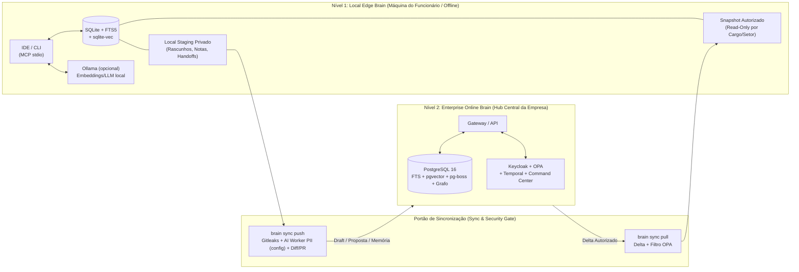

# Arquitetura Híbrida — Local Edge (Offline) ↔ Enterprise Hub (Online)

Para atender empresas com **vários funcionários, cargos e setores diferentes** (Devs, POs, QA, DevOps, AppSec, Comercial, Gestores), o **Project Brain OS 2.0** opera em uma arquitetura híbrida de **dois níveis** — inspirada no modelo distribuído do Git, mas com governança de permissões e IA:

---

## 1. Os Dois Níveis da Arquitetura

### Nível 1 — Local Edge Brain (Offline na máquina do funcionário)
Um cliente leve **Node.js/TypeScript (sem dependência de Python na máquina do usuário)** rodando via **CLI (`brain`), `brain ui`, MCP `stdio` e SQLite (`FTS5`)**. `sqlite-vec` e Ollama são opcionais; sem provedor de embeddings, a busca local usa FTS5. O `apps/ai-worker` Python roda no Hub quando `AI_WORKER_URL` ativa redaction PII em REST/Edge/Git/SaaS ou quando PDF/Office exigirem Docling.

Ele mantém duas áreas estritamente separadas:
1. **Snapshot Autorizado (Somente Leitura):** Cópia offline sincronizada contendo *apenas* os projetos, regras e documentos que o **cargo e o setor** daquele funcionário têm permissão para acessar.
2. **Área de Trabalho Privada (*Local Staging*):** Rascunhos de regras, anotações, experimentos de código, memórias episódicas e *handoffs* produzidos offline **antes** de irem para o cérebro central da empresa.

### Nível 2 — Enterprise Online Brain (Hub Central da Empresa)
O servidor principal usa **PostgreSQL 16 + `pgvector` + `pg-boss`**, com API e worker TypeScript. Keycloak/OPA são ativados para o perfil corporativo; Temporal, Command Center, MinIO e demais serviços entram conforme os fluxos habilitados.

---

## 2. Fluxo de Trabalho: Offline Primeiro → Online Depois

> **Implementação atual:** `brain sync` exige chave aleatória guardada no keychain do sistema e abre o Edge em modo SQLCipher (`better-sqlite3-multiple-ciphers`, perfil SQLCipher legado 4). O runtime mínimo do monorepo é Node.js 22. O modo SQLCipher foi exercitado em macOS arm64; Linux e Windows ainda precisam de validação de execução. Uso direto de `EdgeDatabase` sem `requireSqlCipher` continua podendo usar AES-256-GCM selado ou SQLite sem cifragem, conforme as opções fornecidas.

1. **Pull Seletivo por Cargo/Setor (`brain sync pull`):**
   - Enquanto conectado, o cliente local envia `sync_seq` e `policy_epoch`; os repositórios PostgreSQL registram cada novo item/versão em `sync_changes` na mesma transação do upsert, com `content_hash`. Uma linha de lock por tenant/projeto serializa escritores até o commit para o cursor não saltar uma transação ainda aberta. Regravações idênticas não criam eventos. Com cursor estabelecido e epoch igual, `syncMode: delta` hidrata apenas itens alterados desde o cursor, respeitando RLS, e envia tombstones. Mudanças no conjunto de políticas autorizado, tanto concessões quanto revogações, alteram o epoch. Primeiro sync e mudança de epoch usam `syncMode: snapshot`, paginado por ID em blocos de até 100 itens com watermark fixo; o CLI só troca o Edge local depois da última página. Quando a política muda durante a paginação, o Hub reinicia o snapshot com o novo epoch e o CLI descarta as páginas antigas. O rebuild atômico ocorre em SQLite temporário e faz *swap* após concluir. Em modo apenas em memória, o snapshot continua limitado aos primeiros 100 resultados.
   - O **OPA (Policy Engine)** filtra no servidor antes do envio: um dev de *Pagamentos* baixa código e contratos de Pagamentos; um gestor *Comercial* baixa regras de preço e CRM; ninguém baixa dados confidenciais de outro setor para o disco local.
   - **Limite Offline Real:** O token offline expira em **24h (máximo configurável 7 dias)**; o refresh *não* ocorre sem conexão — expirado o prazo, o SQLCipher bloqueia o acesso local até reconectar ao Hub.
2. **Trabalho 100% Offline (Viagem, Avião, Rascunho Privado):**
   - A IDE ou CLI consulta o **Local Edge Brain** usando SQLite FTS5; `sqlite-vec` e Ollama são usados apenas se instalados e habilitados.
   - Nada sai da máquina nem polui o índice ou modelo central da empresa enquanto ainda for rascunho ou experimento.
3. **Push Controlado para o Sistema Principal (`brain sync push`):**
   - Quando o funcionário volta online e decide compartilhar/publicar o que produziu, os itens passam por um **Portão de Entrada (Ingestion Gate)**:
     - **Segurança Local & Remota:** Gitleaks bloqueia segredos antes do upload. No Hub, quando `AI_WORKER_URL` está configurado, `/redact-pii` sanitiza título e conteúdo do `push`; sem essa configuração, PII não é sanitizada automaticamente.
     - **Governança por Cargo:** O que o funcionário criou offline **nunca** sobrescreve regras oficiais automaticamente — sobe como `draft` / proposta (`brain_change_propose`) para aprovação do responsável daquele setor, ou como memória episódica vinculada à tarefa.
     - **Detecção de Conflitos:** Se outro colega alterou a mesma regra online enquanto o usuário estava offline, o `brain sync push` não sobrescreve nem trava no terminal: envia o rascunho como uma **proposta de conflito (`status: draft`, `conflictWithVersion`)** e abre um diff/PR visual no **Project Command Center / GitHub** para resolução humana.

---

## 3. Proteções para Múltiplos Cargos e Setores

- **Revogação Automática (*Policy Revocation*):** O CLI envia no `brain sync pull` o conjunto de políticas já presente no Edge. O Hub compara com as políticas autorizadas para o ator, retorna `revokedPolicies` e atualiza um `policyEpoch` persistido por tenant/projeto/ator quando PostgreSQL está ativo; retries da mesma revogação são idempotentes. O CLI apaga do SQLite os itens das políticas revogadas. Em modo apenas em memória, o epoch é idempotente durante a vida do processo, mas não sobrevive a reinício. Após o bootstrap, o Hub consome `sync_changes` para montar deltas autorizados e tombstones; o teste live cobre alteração persistida, snapshot com mais de 100 itens e upsert idempotente. Alteração inacessível por RLS vira tombstone. Itens atuais anteriores à ativação do journal entram no snapshot; seus eventos e versões históricos não são reproduzidos. Ainda faltam avaliação integrada em escala e validação em Windows/Linux.
- **Isolamento de Aprendizado (*No Noise in Core*):** Erros temporários, tentativas falhas e rascunhos locais ficam restritos à máquina do funcionário; apenas conhecimento consolidado e validado sobe para o grafo/modelo central da empresa.
- **Painel Offline com Login e Escopo por Usuário/Tenant:** A interface local (`brain ui`) exige sessão/credencial local ou `OfflineLease` válido (sem exposição direta sem login) e reflete as mesmas permissões do usuário (`tenantId`, `actorId`, `allowedProjects`, `allowedPolicies`, visibilidade própria vs. setor) configuradas para o Hub online.
- **Processamento Offline:** Busca e fila local funcionam sem serviço de IA. Quando habilitado, Ollama usa CPU/GPU do usuário para embeddings ou resumos; hardware, energia e armazenamento continuam sendo custos locais.

