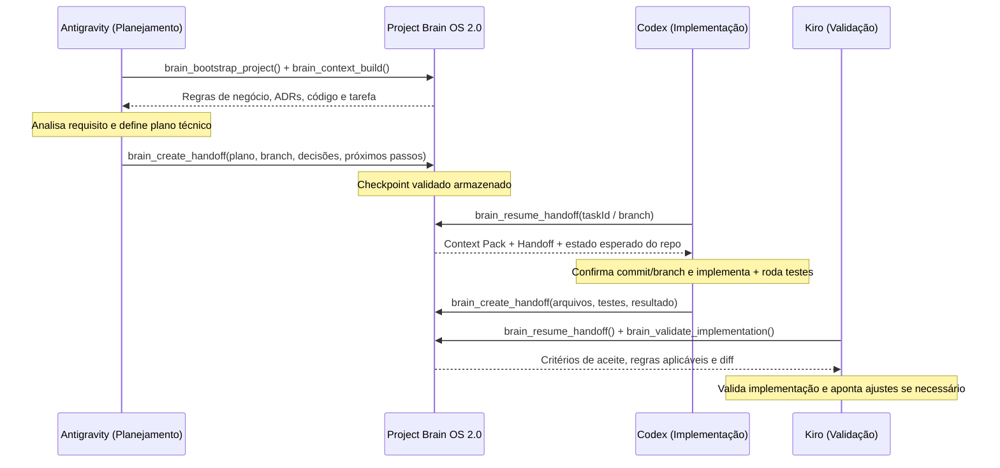

# Universal Agent Gateway e Continuidade entre IDEs

> **Decisão Arquitetural Central:** O **Project Brain OS 2.0** não tenta substituir Antigravity, Codex, Kiro, Cursor, Claude Code ou VS Code. Ele atua como o **cérebro independente e compartilhado** que todas essas ferramentas consultam, mantendo conhecimento, regras, histórico e continuidade de trabalho desacoplados do agente ou modelo utilizado.

---

## 1. Estratégia de Integração por IDE e Agente

A integração respeita as capacidades nativas de cada ferramenta, evitando duplicação da base de conhecimento em arquivos locais gigantes. O Hub expõe MCP remoto por **`apps/api` em `/mcp` (Streamable HTTP)**; `apps/mcp-server` fornece MCP local via `stdio`, combinado com adaptadores de IDE finos.

| Ferramenta | Estratégia de Integração | Experiência Desejada |
| :--- | :--- | :--- |
| **Google Antigravity** | MCP remoto configurado no workspace + regras/skills leves | Recuperar arquitetura, regras e estado antes de planejar/implementar |
| **OpenAI Codex** | MCP + `AGENTS.md` enxuto + skills/agentes | Continuar tarefas com histórico validado e plano aprovado |
| **Amazon Kiro** | MCP + *steering files* + especificações | Validar requisitos, critérios de aceite e decisões do projeto |
| **Cursor** | MCP + regras de projeto (`.cursor/rules`) + extensão complementar | Consultar regras e impactos em tempo real durante a edição |
| **Claude Code** | MCP + `CLAUDE.md` enxuto + comandos/skills | Compartilhar memória entre sessões e outros agentes |
| **VS Code** | Extensão própria (`apps/ide-extension-vscode`) + API REST | Painel nativo do Second Brain, alertas e visualização de regras |
| **JetBrains** | Plugin próprio (`apps/ide-plugin-jetbrains`) ou assistente compatível | Navegar pelo conhecimento e tarefas direto no editor |
| **Continue / Cline** | Adaptadores MCP onde suportados | Compartilhar contexto, regras e tarefas |

> **Nota de Realismo:** Cada ferramenta possui versões, eventos e modelos de permissão distintos. Os adaptadores (`packages/agent-adapters/`) abstraem apenas o necessário, sem assumir que todas as IDEs suportam os mesmos hooks automáticos.

---

## 2. Ciclo Automático de Contexto no Workspace

Sempre que um desenvolvedor ou agente interage em um workspace conectado:

1. **Detecção do Workspace (`packages/workspace-detection`):** Identifica `projectId`, repositório remoto, branch atual e commit base (via `.project-brain.json` ou `protocols/project-manifest/`).
2. **Carga de Governança:** Recupera regras de desenvolvimento, arquitetura e segurança aplicáveis ao projeto.
3. **Identificação da Tarefa:** Localiza a tarefa ou *handoff* ativo associado à branch ou ao usuário.
4. **Montagem do Context Pack:** Entrega requisitos, regras de negócio, ADRs, código relacionado e critérios de aceite respeitando o orçamento de tokens.
5. **Pré-verificação de Impacto:** Antes de alterações críticas, consulta `Architecture Guardian` e `Business Rule Guardian`.
6. **Registro Pós-Execução:** Grava descobertas, arquivos alterados, testes executados e resultados na memória episódica.
7. **Retomada Cross-IDE:** Ao abrir o mesmo projeto em outra IDE, oferece o resumo validado e os próximos passos prontos para continuar.

---

## 3. Como Conectar Antigravity, Codex e Kiro na Prática

Em vez de manter cópias divergentes de documentação para cada ferramenta:
- **Fonte Única:** A API Fastify (`apps/api`) expõe MCP remoto e REST; o processo `apps/mcp-server` é o adaptador local `stdio` para clientes que iniciam um subprocesso.
- **Adaptadores Locais Finos:**
  - No **Antigravity**: configuração do servidor MCP no workspace apontando para o gateway autenticado.
  - No **Codex**: `AGENTS.md` curto instruindo o agente a chamar `brain_bootstrap_project` / `brain_resume_handoff` ao iniciar e `brain_create_handoff` ao concluir.
  - No **Kiro**: *steering file* curto apontando para as ferramentas MCP de requisitos, critérios de aceite e validação (`brain_validate_implementation`).

---

## 4. Funcionalidade Especial: Agent Continuity Protocol (`Universal Agent Handoff`)

O **Agent Continuity Protocol** permite transferir uma tarefa entre IDEs e agentes preservando objetivo, branch, arquivos modificados, testes executados, decisões e próximos passos.

### Ponto Crítico: Memória Compartilhada != Workspace Compartilhado

> **Atenção Arquitetural:** Ter memória compartilhada no Project Brain OS **não** garante que a segunda IDE esteja vendo os mesmos arquivos locais (principalmente se houver alterações ainda não commitadas).

Para que a continuidade funcione sem erros:
1. O protocolo `protocols/agent-handoff/` registra obrigatoriamente: `repoUrl`, `branch`, `baseCommitSha`, `workingTreeDirty`, `modifiedFiles` (normalizados em POSIX `/` para compatibilidade Windows/Linux/macOS) e `testsExecuted`.
2. **Sincronização Real de Código (Patch / Branch Efêmera Remota):** Ao criar handoff com alterações locais não commitadas, o CLI tenta publicar uma branch efêmera (`handoff/<taskId>`) no remoto Git. Se não houver escrita no remoto, usa patch criptografado no MinIO quando esse serviço estiver habilitado. Se nenhum meio de transferência estiver disponível, a criação do handoff retorna erro acionável e não marca o código como transferido. Arquivos `.env` nunca são incluídos; somente o schema `.env.example` pode ser verificado via `brain env check`.
3. Se houver divergência de branch ou commit, o sistema emite um alerta claro antes que o próximo agente edite código desatualizado (ou sincroniza via `brain handoff checkout <id>`).
4. **Lock Otimista entre Agentes (*Task & File Leases*):** Ao chamar `brain_resume_handoff` ou iniciar uma tarefa, o Hub registra um *lease* suave com TTL no PostgreSQL (Valkey opcional para escala horizontal) (`actorId`, `branch`, `targetFiles`). Se outro dev ou agente tentar atuar nos mesmos arquivos, o `Context Pack` emite um aviso em `warnings[]`.

---

## 5. Compatibilidade Real entre Clientes MCP & Adoção Gradual no CI

- **Tudo via 13 Tools Canônicas:** Como alguns clientes MCP ignoram `Resources` ou `Prompts` e enxergam apenas `Tools`, toda funcionalidade essencial do **Project Brain OS 2.0** é exposta pelas 13 `Tools` em `snake_case`.
- **Bridge `stdio` Universal (`brain mcp connect <url>`):** Para IDEs ou harnesses que só aceitam transporte `stdio` local e ainda não suportam `Streamable HTTP` remoto, a CLI atua como ponte local autenticada para o Hub remoto.
- **Adoção Gradual no CI/CD Existente:** Os *Architecture* e *Business Rule Guardians* operam em 3 níveis progressivos configuráveis no `.project-brain.json` para não quebrar pipelines legados no dia 1:
  1. `audit` (apenas registra alertas no Command Center)
  2. `advisory` (comenta no PR sem bloquear merge)
  3. `enforced` (bloqueia apenas arquivos novos ou rotas críticas marcadas com `@brain-rule`)

