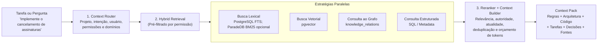

# Estratégia de Recuperação, Memória e Performance

O segredo da eficiência do **Project Brain OS** não é enviar milhares de documentos para o LLM, mas identificar a intenção, filtrar com segurança, combinar múltiplos sinais de busca e entregar um **Context Pack** pequeno, verificável e atualizado.

---

## 1. Pipeline de Recuperação Híbrida (`Context Engine` + `Retrieval Engine`)

### Etapas Detalhadas

0. **Política Oficial de Chunking (Pré-Indexação):**
   - **Código-fonte:** chunking semântico por **símbolo AST** (função, método, classe ou interface via `web-tree-sitter`) até `800 tokens`; arquivos/classes maiores são quebrados por método preservando header da classe e imports.
   - **Markdown / ADRs / PDFs:** chunking hierárquico por **seção (`H2`/`H3`)** com janela máxima de **`512 tokens`** e **`64 tokens` de overlap**, mantendo o título do documento e breadcrumb de cabeçalhos no topo de cada chunk.

1. **Context Router (`packages/context-engine`)**
   - Identifica `tenantId`, `projectId`, `actorId` e suas permissões (`accessPolicyIds` permitidos).
   - Classifica a intenção da tarefa (ex.: *implementar feature*, *corrigir bug*, *analisar impacto*, *responder dúvida de negócio*).
   - Seleciona os domínios prioritários entre os 12 domínios (ex.: para *"Implemente o cancelamento de assinaturas"*, ativa domínios `02 Regras de negócio`, `03 Arquitetura`, `04 Padrões`, `05 Código`, `06 Tarefas` e `07 Decisões`).

2. **Hybrid Retrieval (`packages/retrieval`)**
   - **Regra de Segurança:** Todas as consultas aplicam filtro de `tenant_id`, `project_id` e `access_policy_id` **antes** do cálculo de score ou similaridade.
   - **Busca Lexical:** O padrão é PostgreSQL FTS (`ts_rank_cd` sobre `search_vector`); ParadeDB fornece BM25 quando instalado como upgrade. Ambos produzem uma lista lexical ordenada com o mesmo contrato.
   - **Busca Vetorial (`pgvector`):** Encontra trechos semanticamente próximos quando a terminologia varia.
   - **Consulta ao Grafo (`packages/graph`):** A partir dos nós iniciais encontrados, expande 1 a 2 saltos (`GOVERNED_BY`, `IMPLEMENTS`, `DECIDED_BY`, `VERIFIED_BY`, `DEPENDS_ON`).
   - **Consulta Estruturada:** Busca direta por status (`approved`), tarefas abertas relacionadas ou filtros por tipo/tags.

3. **Reranker + Context Builder**
   - **Fórmula Normalizada `[0.0, 1.0]`:** `score = 0.45 * rrf(lexical, vector) + 0.25 * graph_proximity + 0.15 * authority_weight + 0.10 * recency_decay + 0.05 * hit_rate_boost`. `lexical` é a lista PostgreSQL FTS (`ts_rank_cd`) no padrão ou ParadeDB BM25 se instalado; `vector` é a lista pgvector. Para listas, `rrf = sum(1 / (60 + rank)) / (2 / 61)`, com rank começando em 1 e contribuição zero quando o item não aparece naquela lista. `graph_proximity = 1 / (1 + hops)`, `authority_weight` é `1.0` para fato oficial, `0.5` para draft e `0.2` para fonte untrusted, `recency_decay = exp(-dias / 90)` e `hit_rate_boost` é a taxa normalizada de acertos do item.
   - **Desempate:** se a diferença de score final entre dois candidatos for `< 0.01`, prevalece `status = 'approved'` e `is_inferred = false`.
   - Remove duplicatas e aplica **contexto hierárquico**: traz resumos de módulos/projetos primeiro e expande o código completo ou detalhes apenas dos itens de maior relevância dentro do **orçamento de tokens** definido.
   - **Federated Context Pack (Microsserviços):** Quando o projeto consome ou publica contratos para outros serviços no `Cross-Service Contract Registry`, inclui automaticamente os contratos públicos (OpenAPI/AsyncAPI/Protobuf) e regras compartilhadas dos serviços vizinhos autorizados, sem vazar código interno privado.
   - **Modo Raio-X (`brain context explain "<tarefa>"` / `--explain`):** Expõe em detalhe o score BM25, score vetorial, saltos no Knowledge Graph, itens filtrados pelo OPA e tokens gastos por bloco, tornando a montagem do contexto 100% auditável e debugável.
   - Anexa citações obrigatórias (`id`, `sourceVersion`, `sourceUri`), avisos de conflito e lacunas conhecidas.

### O que o Agente Recebe no Context Pack (Exemplo)
Para *"Implemente o cancelamento de assinaturas"*:
- Regras de cancelamento, reembolso e cobrança proporcional (`BR-SUB-014`).
- Serviço responsável (`subscription-service`) e suas dependências.
- Interfaces, APIs e tabelas envolvidas.
- Padrões obrigatórios de implementação (`04-engineering/`).
- Tarefas abertas e critérios de aceite (`TASK-482`).
- Decisões arquiteturais anteriores (`ADR-021`).
- Testes existentes e riscos conhecidos (`subscription-cancel.spec.ts`).

---

## 2. Estratégia de Memória em 5 Camadas (`packages/memory`)

O sistema separa a memória por ciclo de vida e nível de governança:

| Camada | Conteúdo | Persistência | Governança |
| :--- | :--- | :--- | :--- |
| **1. Working Memory** | Contexto imediato da tarefa/sessão atual | Hub: PostgreSQL temporário; Edge: SQLite; TTL de 24h | Isolada por sessão |
| **2. Episodic Memory** | Sessões passadas, execuções, comandos, erros e descobertas | Histórica, com política de retenção | Rastreável por `sessionId` e `agentId` |
| **3. Semantic Memory** | Fatos e aprendizados consolidados de múltiplas execuções | Longa (PostgreSQL) | Marcada como `confidence < 1.0` até validação |
| **4. Procedural Memory** | Como desenvolver, testar, fazer deploy e operar | Versionada (Git / `04-engineering/`, `06-operations/`) | Revisão via PR |
| **5. Organizational Memory** | Estratégia, regras de negócio e decisões oficiais | Governada (imutável ou *supersede*) | Aprovação humana obrigatória |

> **Regra essencial:** Uma conclusão gerada por IA na *Working* ou *Episodic Memory* **nunca** sobrescreve automaticamente a *Organizational Memory*. Ela deve ser proposta via `brain_change_propose` ou marcada explicitamente como inferência (`is_inferred = true`).

> **Memory Decay & Cold Archiving:** Para evitar que sessões antigas poluam a busca após meses de operação, um job periódico compacta memórias episódicas com mais de 60 dias e baixo *Context Hit Rate* em resumos semânticos, arquivando os logs brutos no MinIO/S3 (*cold storage*).

---

## 3. Arquitetura de Alta Performance

1. **Indexação Incremental:**
   - Calcula `content_hash` (SHA-256) por arquivo/entidade e monitora commits Git / eventos de webhook.
   - Apenas arquivos, símbolos AST e chunks modificados são reprocessados e re-embeddados.
2. **Contexto Hierárquico:**
   - Indexa resumos em nível de projeto e módulo (`00-overview/`, `summary`) para roteamento rápido, expandindo arquivos completos sob demanda.
3. **Cache por Versão e Permissão:**
   - Cache LRU no processo cobre execução single-node; Valkey 8 é opcional para múltiplas réplicas.
   - A chave inclui `(tenantId, projectId, policyHash, indexVersion)` e TTL máximo de 5 minutos. A resposta continua submetida a RLS, mesmo em cache.
4. **Loop de Feedback de Utilidade (`Context Hit Rate`):**
   - Ao final de uma sessão ou tarefa (via `brain_record_learning` ou evento de diff pós-sessão), calcula-se `hit_rate = hits / itens_enviados` dentro da mesma sessão. Um item conta como `hit` apenas quando: (a) foi consultado via `brain_knowledge_get`, (b) teve seu `id`/`sourceUri` citado na resposta/handoff, ou (c) seu arquivo/símbolo associado sofreu edição vinculada à `taskId` ativa (evitando falsos hits em edições não relacionadas).
   - Itens enviados repetidamente sem utilidade perdem prioridade no *Reranker*; itens buscados juntos com frequência criam reforços no grafo (`CO_ACCESSED_WITH`), tornando os próximos `Context Packs` menores e mais precisos.
   - **Estado implementado (2026-11-17):** `context_session_items` registra fontes distintas entregues por `(tenant, projeto, ator, sessão, item)` e evidências idempotentes `read`, `citation` e `edit`. O denominador inclui somente fontes do Context Pack; busca direta não entra. `edit` exige lease ativo do mesmo ator e tarefa vinculada. No primeiro envio, arquivos locais elegíveis sob o workspace configurado recebem baseline SHA-256; no feedback, o Noema detecta mudanças sem depender de `editedPaths`. Esse campo, quando enviado, apenas restringe os caminhos detectados. URIs remotas, arquivos indisponíveis e caminhos fora do workspace não têm detecção automática. O retrieval usa `context_hit_count / context_sent_count`, limitado a `[0,1]`; `hit_count` permanece legado. Primeira evidência de hit cria arestas direcionais inferidas `CO_ACCESSED_WITH` com itens já hit na sessão; reuso reforça confiança e atualiza `created_at`.

---

## 4. Metas Iniciais de Performance e Avaliação (`packages/evaluation`)

> **Hipóteses de Trabalho:** Os alvos p95 abaixo são hipóteses a validar com benchmark reproduzível de busca vetorial exata no subconjunto autorizado e filtros reais de `tenant_id` e `access_policy_id` via RLS. HNSW/`iterative_scan` só entram em benchmark de upgrade após os testes de isolamento do item 26 das decisões normativas. A latência de geração do LLM consumidor na IDE é medida separadamente.

| Métrica | Meta Inicial (p95) |
| :--- | :--- |
| Busca lexical (PostgreSQL FTS) | `< 150 ms` |
| Recuperação híbrida (FTS + Vetor + Grafo) | `< 800 ms` |
| Montagem do `Context Pack` completo | `< 2 s` |
| Atualização incremental de índice após evento | `< 60 s` |

### Métricas de Qualidade Contínua (`tests/retrieval-evals/`)
- **Precision@K e Recall@K** da recuperação híbrida.
- **Estado do eval atual:** 100 consultas sintéticas únicas, um projeto, Recall@5 = 1,0 e zero fontes proibidas. A fração conhecida de fontes esperadas entre as entregues é 48,0%, mas não é Precision@K porque as anotações não enumeram todas as fontes relevantes; precisão real, citações e respostas sem suporte ainda aguardam rótulos completos e consultas observadas.
- **Taxa de citações corretas** (respostas ancoradas em `sourceId` + `sourceVersion` reais).
- **Taxa de respostas sem suporte** (alucinações ou afirmações sem evidência).
- **Custo por consulta** (tokens no `Context Pack` + chamadas de embedding/rerank).
- **Taxa de vazamento entre projetos/tenants** (deve ser estritamente `0%`).

