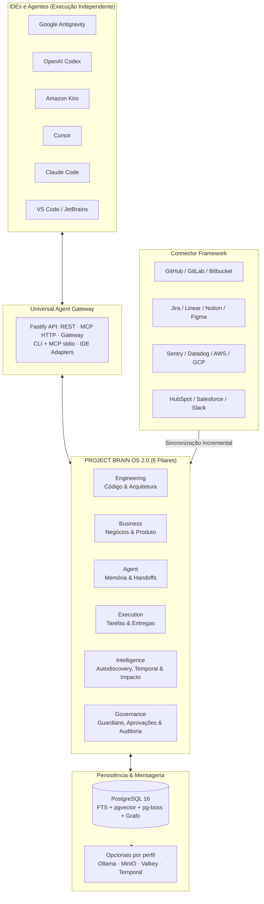

# Visão Geral do Sistema — Project Brain OS 2.0

## 1. Arquitetura Macro: Um Cérebro, Vários Agentes

O **Project Brain OS 2.0** evolui o conceito de monólito modular com workers assíncronos para uma **Universal Project Intelligence Platform**. O núcleo mantém o conhecimento, a governança e a continuidade, enquanto uma camada dedicada de **Universal Agent Gateway** conecta múltiplas IDEs e agentes sem acoplar o conhecimento a uma ferramenta específica.



---

## 2. Os 12 Domínios de Conhecimento

Para evitar que informações de negócio sejam confundidas com decisões técnicas ou tarefas temporárias, o conhecimento é segregado em **12 domínios explícitos**, cada um com responsáveis, fontes oficiais, regras de atualização e permissões próprias:

| # | Domínio | Escopo Principal | Fontes Oficiais Típicas | Regra de Atualização |
| :--- | :--- | :--- | :--- | :--- |
| **01** | **Identidade e estratégia** | Visão do produto, objetivos, KPIs, posicionamento, personas, mercado e proposta de valor | `00-overview/`, OKRs, docs executivos | Revisão humana obrigatória |
| **02** | **Regras de negócio** | Políticas comerciais, cálculos, limites, condições, exceções, fluxos e validações | `01-business/business-rules/`, ERP/CRM | Aprovação do Product/Business Owner |
| **03** | **Arquitetura de software** | Serviços, módulos, dependências, contratos, integrações, diagramas e ADRs | `03-architecture/`, OpenAPI, ADRs | Aprovação via PR / Tech Lead |
| **04** | **Padrões de desenvolvimento** | Convenções, SOLID, DDD, Clean Architecture, qualidade, testes e code review | `04-engineering/`, linters, guidelines | Versionado via Git (Engineering) |
| **05** | **Código e estrutura** | Repositórios, classes, funções, símbolos, APIs, esquemas, migrações e dependências | Repositórios Git, AST (Tree-sitter), LSP | Indexação incremental automática por commit |
| **06** | **Tarefas e planejamento** | Backlog, épicos, histórias, bugs, prioridades, sprints, responsáveis e critérios de aceite | Jira, Linear, GitHub Issues, `05-execution/` | Sincronização via webhooks/polling |
| **07** | **Decisões e histórico** | Quem decidiu, justificativas, alternativas rejeitadas, datas e decisões substituídas | ADRs, registros de reunião validados | Imutável após aprovação (apenas *supersede*) |
| **08** | **Operações e infraestrutura** | Ambientes, deploys, runbooks, observabilidade, incidentes e SLOs | `06-operations/`, Terraform, CI/CD, alertas | Automática (deploys/incidentes) + revisão |
| **09** | **Clientes e operações comerciais** | Segmentos, jornadas, contratos, feedbacks, suporte e oportunidades | CRM, tickets de suporte, pesquisas | Sincronização com mascaramento de PII |
| **10** | **Dados e métricas** | Dicionário de dados, eventos, indicadores, métricas, fontes e qualidade dos dados | Schemas de analytics, dbt, catálogo de dados | Automática por pipeline + curadoria |
| **11** | **Segurança e compliance** | Permissões, classificação de dados, requisitos legais (LGPD), ameaças e auditoria | Políticas oficiais (`policies/`), threat models | Aprovação estrita de Segurança/Legal |
| **12** | **Memória dos agentes** | Contexto de sessões, planos, descobertas, resultados, erros e aprendizados validados | `08-agent-memory/`, runtime de agentes | Automática (episódica) + promoção validada |

> **Regra fundamental:** Uma inferência gerada por IA (domínio 12) **nunca** se torna automaticamente uma regra oficial sem passar por validação humana ou fluxo de aprovação explícito.

---

## 3. Estrutura Completa do Repositório (2.0)

> Os diretórios abaixo representam a arquitetura modular proposta para o sistema completo (evoluída incrementalmente conforme o roadmap).

```text
project-brain-os/
├── apps/                                # Aplicações executáveis e clientes
│   ├── api/                             # API principal (Fastify) — também monta /mcp (HTTP) e /gateway no Hub
│   ├── web/                             # Project Command Center (Next.js) — também servido localmente via `brain ui`
│   ├── mcp-server/                      # Entrypoint MCP local (`stdio`); HTTP remoto servido por `apps/api`
│   ├── cli/                             # CLI multiplataforma (`brain`) + servidor local `brain ui` para não-técnicos
│   ├── worker/                          # Workers assíncronos TypeScript + pg-boss
│   ├── ai-worker/                       # Opcional: Python para Docling/Presidio quando ativados
│   ├── agent-runner/                    # Módulo do Runner; Hub no worker, Edge na CLI
│   ├── ide-extension-vscode/            # Extensão nativa para VS Code
│   ├── ide-plugin-jetbrains/            # Plugin para família JetBrains
│   └── desktop/                         # Wrapper Tauri opcional sobre `apps/web` / `brain ui`
│
├── packages/                            # Núcleo modular da plataforma
│   ├── core/                            # Entidades, tipos, contratos e erros
│   ├── auth/                            # Autenticação (OIDC) e RBAC/ABAC
│   ├── agent-adapters/                  # Adaptadores finos por ferramenta
│   │   ├── antigravity/
│   │   ├── codex/
│   │   ├── kiro/
│   │   ├── cursor/
│   │   └── claude-code/
│   ├── agent-handoff/                   # Protocolo de continuidade entre sessões/IDEs
│   ├── workspace-detection/             # Detecção automática de repo, branch e contexto
│   ├── project-discovery/               # Autodiscovery de código, stack e arquitetura
│   ├── code-intelligence/               # Parser AST (Tree-sitter), LSP, símbolos e deps
│   ├── knowledge/                       # Ontologia, versionamento e fatos
│   ├── temporal-knowledge/              # Consultas históricas por commit/período
│   ├── business-traceability/           # Rastreabilidade negócio <-> código <-> testes
│   ├── memory/                          # Memórias em 5 camadas e consolidação
│   ├── retrieval/                       # Busca híbrida (PostgreSQL FTS + pgvector + Grafo + SQL)
│   ├── context-engine/                  # Roteamento, reranking e montagem de Context Packs
│   ├── context-optimizer/               # Otimização de orçamento de tokens e cache
│   ├── graph/                           # Operações no Knowledge Graph
│   ├── rules-engine/                    # Motor de regras de negócio e políticas
│   ├── architecture-guardian/           # Validação de violações arquiteturais e PRs
│   ├── business-rule-guardian/          # Validação de impacto em regras comerciais
│   ├── impact-analysis/                 # Análise de impacto cross-project
│   ├── task-engine/                     # Tarefas, critérios de aceite e planner
│   ├── knowledge-health/                # Detecção de conflitos, lacunas e obsolescência
│   ├── workflow-orchestrator/           # Orquestração de fluxos de revisão e CI
│   ├── connector-framework/             # Base para conectores incrementais
│   ├── approval-engine/                 # Fluxos de aprovação humana
│   ├── audit-engine/                    # Trilha de auditoria e compliance
│   ├── evaluation/                      # Evals de retrieval e citações
│   └── observability/                   # OpenTelemetry (logs, traces e métricas)
│
├── integrations/                        # Conectores externos sobre o Connector Framework
│   ├── github/
│   ├── gitlab/
│   ├── jira/
│   ├── linear/
│   ├── notion/
│   ├── figma/
│   ├── slack/
│   └── google-drive/
│
├── protocols/                           # Contratos formais e schemas (JSON Schema / Proto)
│   ├── context-pack/                    # Formato padrão de pacote de contexto
│   ├── agent-handoff/                   # Formato padrão de transferência entre agentes
│   ├── knowledge-events/                # Eventos de atualização e invalidação
│   ├── project-manifest/                # Manifesto declarativo do projeto no workspace
│   ├── runner-tasks/                    # Contrato de tarefas e cron para o Brain Runner
│   └── edge-sync/                       # Protocolo de sincronização Edge Offline <-> Hub Online
│
├── data/                                # Dados versionados e políticas
│   └── knowledge/
│       ├── organization/
│       ├── projects/
│       ├── templates/
│       └── policies/
│
├── infra/                               # Deploy e operações
│   ├── docker/
│   ├── terraform/
│   ├── kubernetes/
│   └── monitoring/
│
└── tests/                               # Suíte de testes
    ├── unit/
    ├── integration/
    ├── retrieval-evals/
    └── security/
```
