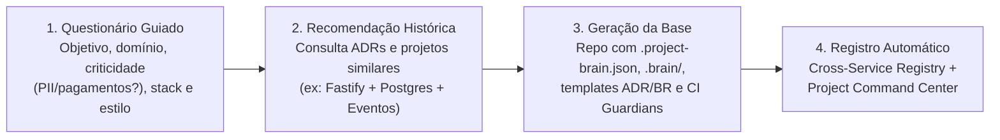

# Perfis Organizacionais, Microsserviços e Project Blueprinting

O **Project Brain OS 2.0** atende toda a organização de tecnologia — de desenvolvedores a CTOs, DevOps, QA e AppSec — e foi projetado para ambientes reais com **múltiplos projetos e microsserviços independentes**, além de acelerar a criação de novos serviços dentro dos padrões da empresa.

---

## 1. Valor por Perfil na Organização

### A. Desenvolvedores (Devs)
- **Onboarding Instantâneo em Qualquer Repo:** Ao abrir um serviço desconhecido, o dev (ou seu agente via `brain_bootstrap_project`) recebe o mapa do serviço, endpoints, tabelas, eventos que consome/publica e *"pegadinhas conhecidas"* daquele código.
- **Contract-Aware Coding:** Ao alterar um payload ou evento em um microsserviço A, a IDE avisa imediatamente quais microsserviços B e C consomem aquele contrato (OpenAPI / AsyncAPI / Protobuf) antes mesmo de abrir o PR.

### B. Diretores de Tecnologia / CTO
- **Visão Executiva de Risco, Dívida e Alinhamento:** Painel no *Project Command Center* respondendo perguntas estratégicas:
  - *"Quais projetos estão usando bibliotecas vulneráveis ou versões obsoletas?"*
  - *"Onde temos regras de negócio críticas sem testes ou sem dono definido?"*
  - *"Qual o custo de tokens/IA e ganho de velocidade por time/projeto?"*
- **Governança de Decisões (Tech Radar Corporativo):** Detecta quando um time adota uma tecnologia fora do padrão aprovado pela arquitetura sem uma ADR justificando.

### C. DevOps / SRE / Plataforma
- **Topology & Blast Radius Map:** Conecta repositórios à infraestrutura (Terraform, Kubernetes, Helm, CI/CD) para saber qual serviço roda onde, quais bancos/filas acessa e quem sofre impacto se um recurso cair.
- **Incident-to-Code Memory:** Quando ocorre um incidente em produção (Sentry, Grafana, Datadog), o Brain registra a causa raiz, o *runbook* utilizado e vincula ao módulo de código envolvido — evitando que o mesmo erro seja reintroduzido meses depois por outro dev ou agente.
- **Pre-Deploy Readiness Check:** Valida automaticamente se mudanças de infraestrutura ou variáveis de ambiente possuem documentação de rollback e *runbook* atualizados.

### D. QA (Quality Assurance)
- **Business-Rule-to-Test Coverage Matrix:** Cruza todas as `BusinessRule` aprovadas com a suíte de testes (`VERIFIED_BY`) para mostrar exatamente quais regras de negócio possuem teste automatizado e quais estão descobertas.
- **Test Impact Selection & Geração de Cenários:** Dado um PR ou `Agent Handoff`, lista os fluxos E2E/integrados que precisam de regressão (incluindo serviços consumidores) e gera propostas de casos de teste a partir dos critérios de aceite e exceções da regra.

### E. Profissionais de Segurança (AppSec / SecOps / CISO)
- **Threat Model Vivo & Data Classification:** Mapeia automaticamente quais endpoints/serviços manipulam dados sensíveis (`confidential-business`, PII/LGPD, pagamentos) e exige revisão de AppSec no PR sempre que um código tocar nessas rotas.
- **Security Policy-as-Code (OPA + Semgrep):** Garante que todo microsserviço cumpra autenticação OIDC, validação de entrada, *rate limit* e headers de segurança antes do primeiro deploy.
- **Supply Chain & Secret Guard:** Cruza SBOM e dependências entre todos os projetos da organização para localizar em segundos onde uma CVE crítica está sendo utilizada.

---

## 2. Múltiplos Projetos e Microsserviços (Visão Distribuída)

Em arquiteturas distribuídas, os projetos são independentes, mas se comunicam por APIs e eventos. O sistema estende o isolamento por `projectId` com três mecanismos federados:

1. **Cross-Service Contract Registry:**
   - Catálogo vivo de contratos entre projetos (REST/OpenAPI, gRPC/Protobuf, eventos Kafka/RabbitMQ/SQS) conectando **Produtor -> Tópico/Endpoint -> Consumidores** no Knowledge Graph (`CONSUMES_API`, `PUBLISHES_EVENT`, `SUBSCRIBES_TO`).
2. **Federated Context Pack:**
   - Ao trabalhar no *Serviço de Pagamentos*, o `brain_context_build` recupera o contexto completo do próprio serviço **mais** apenas os contratos públicos e regras compartilhadas dos serviços vizinhos (*Assinaturas*, *Notificações*), respeitando rigorosamente o `access_policy_id` para nunca vazar código privado não autorizado.
3. **Distributed Impact Analysis:**
   - Permite simular via `brain_analyze_change_impact`: *"Se eu alterar o campo X do evento `subscription.canceled`, quais microsserviços consumidores quebram?"* antes de alterar uma linha de código.

---

## 3. Auxílio para Iniciar Novos Projetos (`Project Blueprinting & Scaffolding`)

Ao iniciar um novo projeto ou microsserviço via CLI (`brain scaffold`) ou assistente no *Command Center*:

1. **Questionário Guiado de Arquitetura e Negócio:** Pergunta objetivo, domínio, se manipula PII ou dados financeiros, stack preferida e estilo de comunicação (API síncrona vs. mensageria).
2. **Recomendação Baseada em Histórico:** Consulta ADRs e projetos semelhantes da organização (ex.: *"Para serviços de billing, o padrão aprovado é Fastify + PostgreSQL FTS + eventos assíncronos conforme ADR-012"*).
3. **Geração da Base Pronta para Uso:**
   - Cria o repositório já configurado com `.project-brain.json`, estrutura `.brain/` inicial, templates de ADR/Regras de Negócio, pipeline CI com *Architecture/Security Guardians* e políticas OPA/Semgrep da organização.
   - Registra o novo serviço automaticamente no **Cross-Service Contract Registry** e no **Project Command Center**.

