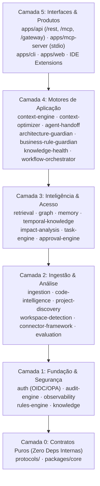

# Blueprint de Construção — Ordem de Execução e Dependências

Este documento organiza a **ordem exata de construção** do **Project Brain OS 2.0**, definindo fronteiras rígidas entre pacotes do monólito modular para evitar acoplamento circular, retrabalho e gargalos durante o desenvolvimento.

---

## 1. Grafo de Dependências entre Camadas / Layers (Regra de Ouro)

> **Regra:** Um pacote só pode importar pacotes da sua própria camada (quando permitido) ou de camadas **inferiores** (`L5 → L4 → L3 → L2 → L1 → L0`). `apps/` é apenas camada de entrega (*thin adapters*), enquanto toda lógica de negócio e inteligência vive isolada em `packages/`. Importações invertidas ou circulares são bloqueadas no CI (`dependency-cruiser`).

---

## 2. Sequência de Construção por Estágio

### Estágio 0 — Contratos, Banco e Infraestrutura Base
1. Definir contratos canônicos em **JSON Schema** em `protocols/` (`context-pack`, `agent-handoff`, `knowledge-events`, `project-manifest`, `runner-tasks`, `edge-sync`), derivando tipos TS e validações Fastify/TypeBox.
2. Implementar entidades base e erros padronizados em `packages/core`.
3. Subir **PostgreSQL 16 + `pgvector >= 0.8` + `pg-boss`** e rodar migrations iniciais em **`packages/database`** (Drizzle ORM).
4. **Critério de Saída:** Fluxo base pronto para aceitar `knowledge_items`, FTS + `pgvector` (`bge-m3` 1024d), `knowledge_item_versions` e `knowledge_relations` com RLS.

### Estágio 1 — Segurança, Auditoria e Camada Git
1. `packages/auth` (API Key local; OIDC Keycloak + OPA no perfil corporativo) e `packages/audit-engine`.
2. `packages/observability` (OpenTelemetry) para que toda requisição nasça rastreável.
3. `packages/knowledge` (leitura/validação de `.brain/` e `data/knowledge/projects/{id}/` com `gray-matter` + `js-yaml`).
4. **Critério de Saída:** Nenhum dado entra ou sai sem `tenantId`, `projectId`, `accessPolicyId` e registro em `audit_logs`.

### Estágio 2 — Ingestão Incremental e Code Intelligence
1. `packages/ingestion` (Gitleaks para segredos + chunking oficial AST/Markdown; `apps/ai-worker` Python com `Docling` + `Presidio` ativado sob demanda para PDF/Office e PII de SaaS).
2. Suporte a **repositórios online via GitHub** (`integrations/github/`): *shallow/partial clone* (`--depth 1 --filter=blob:none`) ou GitHub API/webhooks, diferenciando `sourceOrigin: "internal"` de `"external_reference"`.
3. `packages/code-intelligence` (`web-tree-sitter` como base + extração de âncoras `@brain-rule` / `@brain-adr`; Sourcegraph SCIP na etapa semântica).
4. `apps/worker` (TypeScript + **`pg-boss`** sobre PostgreSQL) com **idempotência por `content_hash`**.
5. **Critério de Saída:** Reindexar o mesmo commit duas vezes não duplica chunks, embeddings nem arestas.

### Estágio 3 — Recuperação Híbrida, Grafo e Memória
1. `packages/graph` (travessia recursiva CTE verificando `from_policy_id` e `to_policy_id` em cada salto).
2. `packages/retrieval` (PostgreSQL FTS + busca vetorial exata no subconjunto autorizado + Grafo + RRF). HNSW só após benchmark e validação de isolamento; ParadeDB BM25 e `FlashRank` são upgrades opcionais e não bloqueiam o Context Pack.
3. `packages/memory` (5 camadas) e `packages/context-engine` + `context-optimizer` (orçamento de tokens + *Context Hit Rate*).
4. **Critério de Saída:** `tests/retrieval-evals/` e `tests/security/` passando com **0% de vazamento cross-tenant**.

### Estágio 4 — Gateway Universal, Handoff, Edge Offline e CLI/MCP
1. `apps/api` expõe as **13 ferramentas canônicas `brain_*` via `/mcp` em Streamable HTTP**; `apps/mcp-server` fornece `stdio` local e bridge CLI.
2. `apps/cli` (`brain init`, `brain sync pull/push`, `brain context`, `brain handoff`, `brain validate`, `brain scaffold`).
3. **Local Edge Brain** (SQLite + `FTS5` + `sqlite-vec` opcional + SQLCipher; Ollama opcional) com fila local durável em SQLite, sincronização delta filtrada por OPA, *Policy Revocation* e *Ingestion Gate* (`Gitleaks` + Presidio remoto sob demanda) no `push`.
4. `apps/cli` hospeda o **Brain Runner local** (`brain runner up --local/--provider/--hybrid`) usando a fila SQLite do Edge; o usuário pode selecionar Ollama ou, em macOS compatível quando `fm available` indicar pronto, Apple Foundation Models via `fm`. Provedor e modelo são opcionais; downloads de modelos Ollama exigem configuração explícita, e o Noema não baixa o modelo Apple.
5. `packages/agent-handoff` + `workspace-detection` (branch efêmera `handoff/<taskId>` publicada no remoto Git; patch criptografado no MinIO é fallback opcional quando o remoto não permite escrita).
6. Adaptadores finos em `packages/agent-adapters/` (Antigravity, Codex, Kiro, Cursor, Claude Code).

### Estágio 5 — Guardians, Command Center e Escala Corporativa
1. `architecture-guardian` (Semgrep + `dependency-cruiser`) e `business-rule-guardian` integrados a **GitHub Checks / PR Comments** nos repositórios online.
2. `apps/web` (*Project Command Center*) tem o menu e fluxos parciais para os espaços de Projetos, Agentes e Execuções, Conhecimento, Busca e Contexto, Integrações, Impacto, Operação, Acesso e Políticas, Modelos e Padrões. A Caixa de Entrada e Projetos têm visões de domínio; várias outras ainda mostram JSON ou orientação estática, e precisam virar fluxos operacionais. O cliente exige autenticação explícita; OIDC usa Authorization Code + PKCE e tokens em memória.
3. Fila de aprovação ligada ao `approval-engine`, com diff, fontes, atribuição, justificativa, pedido de alterações, histórico e auditoria. Painel, PR e canal externo são interfaces para a mesma decisão; se Git for a fonte autoritativa, merge do PR continua necessário para publicar conhecimento oficial.
4. `connector-framework` pode notificar e receber decisão explícita por Slack/Teams/Jira/ClickUp/e-mail depois que cada integração for habilitada. Callbacks autenticados e idempotentes mapeiam a identidade externa para um usuário Noema. Perguntas do agente podem receber respostas livres associadas à tarefa; esse texto é não confiável e não equivale a aprovação.
5. `connector-framework` (Nango opcional a partir de 2 conectores SaaS OAuth; Temporal opcional para workflows duráveis) e *Cross-Service Contract Registry* / *Project Blueprinting*.

---

## 3. Governança de Aceite por Estágio

| Estágio | Suítes Obrigatórias no CI | Aprovadores |
| :--- | :--- | :--- |
| **Estágios 0 e 1** | `tests/unit/` + `tests/integration/` (RLS & Migrations) + `tests/security/` (isolamento básico) | Tech Lead *(+ AppSec ou checklist AppSec se não houver AppSec dedicado)* |
| **Estágios 2 e 3** | Todas anteriores + `tests/security/` (Gitleaks/Presidio/Grafo) + `tests/retrieval-evals/` (100+ queries) | Tech Lead + AppSec |
| **Estágios 4 e 5** | Suíte completa (`unit`, `integration`, `retrieval-evals`, `security`, cross-platform CLI/Edge) | Tech Lead + AppSec + QA/Product |

## 4. Padrões Obrigatórios de Engenharia Interna

- **Idempotência Total na Ingestão:** Todo job de worker usa `(tenantId, projectId, sourceUri, contentHash)` como chave idempotente. Falhas parciais permitem *retry* seguro sem corromper índices.
- **Degradação Graciosa (Graceful Degradation):** Se Ollama, FlashRank ou ParadeDB BM25 estiverem indisponíveis, o `Retrieval Engine` continua com PostgreSQL FTS + busca vetorial autorizada + grafo, adicionando aviso em `warnings[]` quando uma capacidade opcional configurada falhar.
- **Isolamento de Erros:** Erros de parsing em 1 arquivo durante o `Autodiscovery` registram falha no item e seguem indexando o restante do repositório.

